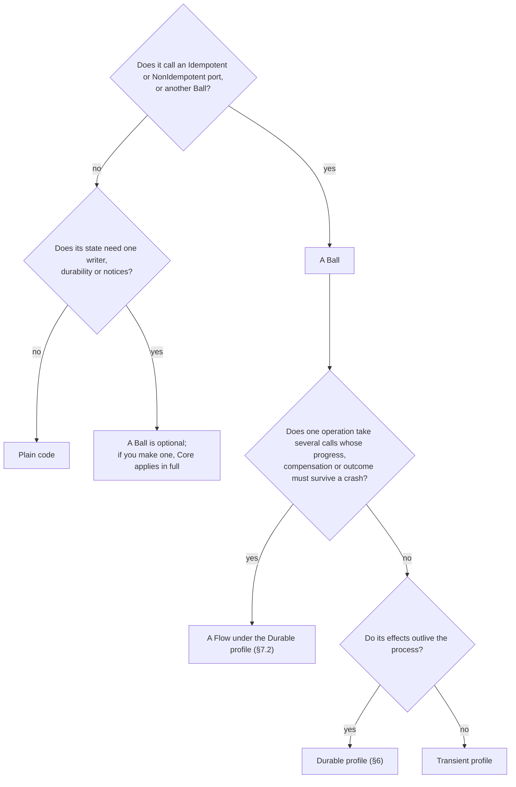

# Decision guide: when Ballarch is worth it

Ballarch has a floor. Code that calls nothing that can take effect twice stays plain code, and Core does not constrain it. Above the floor, a component that requests such an effect becomes a Ball. This guide helps you decide per component, and then per project. It states the costs that follow from the design, not measurements. No study compares Ballarch with another architecture.

## Is it a Ball?

[Core §1](../spec/ballarch-core-2.0.md#1-scope) draws the line. A component needs a Ball when it requests effects whose outcome can be uncertain: calls on Idempotent or NonIdempotent ports, including calls to other Balls. A port whose class you have not established counts as NonIdempotent ([Core §2.6](../spec/ballarch-core-2.0.md#26-declaring-effect-classes)).

**Legend.** Diamonds are questions about one component; boxes are the answer. A Transient Ball whose effects outlive the process can carry an operation key in its request instead ([Core §7.2](../spec/ballarch-core-2.0.md#72-workflows)).

Plain code includes:

- rendering and UI state, form input, focus and scroll;
- navigation;
- derived values, mappers and DTOs, stateless services;
- caches, read models and paging over data another owner holds;
- calls on Safe ports, such as a search or a status read;
- writes whose only effect is one transaction in the store that holds their state, such as CRUD in one database.

Code that calls an Idempotent or NonIdempotent port outside a Ball is outside Core's guarantees, and no claim may cover it ([Core §9.5](../spec/ballarch-core-2.0.md#95-claims)).

The answers form a ladder:

- **Rung 0: plain code.** No effects, no Ballarch.
- **Rung 1: one Ball, one file.** One effect, such as placing an order. The [`place-order` example](../reference/kotlin/examples/place-order/) holds its ports, stages and Ball in one file, and its binding in an `app` sub-package.
- **Rung 2: a Flow with knowledge, under Durable.** Several effects that form one operation, such as a flight and a hotel. The Flow's reply carries one knowledge value ([Core §4.2](../spec/ballarch-core-2.0.md#42-knowledge-of-composite-operations)). The [trip](../reference/kotlin/examples/trip/) and [itinerary](../reference/kotlin/examples/itinerary/) examples are Flows.

[Structuring an application](structure.md) shows where each kind of state goes.

## What you pay

These costs follow from the design ([Core §10](../spec/ballarch-core-2.0.md#10-trade-offs-and-known-limitations)).

- **Durable writes.** Under the Durable profile, an effectful call takes three durable writes: the commit that requests it, its write-ahead record and the commit of its completion. `RuntimeTest` asserts this for one call answered `Done`. Each retry adds a write-ahead record, and entering reconciliation one more. A read takes none.
- **One writer per instance.** A hot key is processed one step at a time.
- **Scheduling.** On a dedicated loop, each input costs a hand-off between threads. A step run on the submitting thread costs none.
- **Explicit stages.** Each stage of an operation is a case of the Ball's state, serialisable under the Durable profile, including a stage for "nobody knows yet" that the UI must show.
- **Dependencies.** A runtime and, under the Durable profile, a store that meets the store contract ([Core §6](../spec/ballarch-core-2.0.md#6-profiles)). The reference runtime is Kotlin/JVM. Its file store locks its directory on one host and has no replication. Several hosts need a store that fences writes ([R16](../spec/ballarch-core-2.0.md#52-runtime-rules)).
- **Deploy discipline.** Under the Durable profile, a deploy meets open obligations. A changed state shape needs a version and a migration. A port, Ball type or subscription that still has open calls or notices must be drained before a deploy removes it, or the runtime refuses to start ([Core §6.1](../spec/ballarch-core-2.0.md#61-evolution)).
- **Declarations nothing verifies.** Effect classes, deduplication windows and delivery horizons come from each destination's contract. Adapter honesty beyond the adapter checks, absorbing compensations and ownership boundaries are left to review.
- **New concepts.** A Ball with its decider, a port and its effect class, the three outcomes, an intent, and a binding in the composition root. Flows add the knowledge value.

## What you get

[Core §1](../spec/ballarch-core-2.0.md#1-scope) lists five properties. A conforming runtime with conforming adapters gives the middle three by construction, for the profile it claims, provided that each declared effect class is correct ([Core §2.6](../spec/ballarch-core-2.0.md#26-declaring-effect-classes)) and each reconciled destination keeps its declared delivery horizon ([Core §10](../spec/ballarch-core-2.0.md#10-trade-offs-and-known-limitations)). The first and the last also need Balls that follow the author rules ([Core §5.1](../spec/ballarch-core-2.0.md#51-author-rules)).

1. **One owner.** Every piece of mutable state that Core governs has exactly one owner, which changes it only by committing its own decisions. *Needs the author rules.*
2. **Nothing leaves early.** No effect is requested before the decision that requests it is committed. *By construction, given correct declarations.*
3. **One honest outcome per call.** Every call ends `Done`, `NotDone` or `Unknown`, and never claims that nothing happened when something may have. *By construction, given correct declarations.*
4. **No split decisions.** A crash never splits a decision: its state change and its requested effects are committed together or not at all. *By construction, given correct declarations.*
5. **No claim beyond the evidence.** A statement about an operation of several calls never claims more than their outcomes establish. A Flow that answers once the operation is settled answers like one honest call, at any depth ([Core §7.4](../spec/ballarch-core-2.0.md#74-composition-closure)). *Needs the author rules.*

The runtime also does, once for every port, what features otherwise do one by one ([Core §3.2](../spec/ballarch-core-2.0.md#32-call-lifecycle)):

- classifies each outcome from the effect class recorded with the call;
- derives idempotency keys, and shares one key among the calls that name one intent;
- retries Safe and Idempotent ports within their budget and attempt timeout, and refuses a retry policy on a NonIdempotent port;
- refuses a call that would end beyond its port's declared deduplication window;
- recovers open calls after a restart under the Durable profile;
- optionally reconciles an unanswered call through a status port after the delivery horizon.

The reference build checks part of the rules: decider purity and module boundaries, composition refusals, fault and crash explorations against ground truth, and a trace checker that a runtime in any language can use. The rest are left to review ([Appendix F](../spec/ballarch-core-2.0.md#appendix-f-checks-and-evidence-in-the-reference-implementations-informative)).

## Use it when

- **Payments, order and form submits, bookings.** A duplicate costs money, and "failed" after a charge sends the user to pay again ([compared with Clean](compared-with-clean.md)).
- **Sync and offline queues.** A request may wait, be repeated or outlive the key the server keeps.
- **Device commands.** An actuator, a doorbell or a FIFO push that must not repeat ([levels](levels.md)).
- **AI-agent tool calls.** A tool call that changes something, and a final report that must not claim more than happened ([agents](ai-agents.md)).
- **Many authors.** Several people or agents write such features, and you want one outcome rule instead of one per feature.

## Prefer something else when

- **The code is stateless, or it is UI.** It stays plain code (§1).
- **The write is CRUD inside one database transaction.** The database already makes it atomic.
- **A single key needs many concurrent writers.** One writer per instance makes a hot key a queue.
- **The state needs consensus or replication across nodes.** Core does not specify it (§1).
- **A control loop cannot afford a commit per input.** Keep the loop plain, and apply Ballarch at the actuator command only.
- **An invariant spans owners and must hold atomically.** One decision cannot enforce it. Use the database, a reservation or a coordinating Ball.
- **A transactional stream processor already owns the pipeline.** If it commits state and output together, a Ball inside it duplicates that ledger.
- **It is a one-shot script.** A person watches the outcome, and there is nothing to recover.
- **You already run a durable execution engine.** Compare its guarantees with what your application needs before adding a second runtime contract (see the [FAQ](faq.md)).
- **A few effectful flows are owned by people who know their failure modes.** Careful hand-written code can be as correct; Ballarch moves that care into one runtime, and costs a runtime to do it.

## Not yet known

These are not measured. Do not assume them either way.

- Whether coding agents do better with Ballarch. The agent skill has not been evaluated.
- Whether it changes productivity, review effort, onboarding or defect rates in a team.
- How it composes across levels: no reference composes a service with firmware or hardware ([Core §11](../spec/ballarch-core-2.0.md#11-interpretation-across-levels-informative)).
- How it behaves with a production store, over a real network and under production load.
