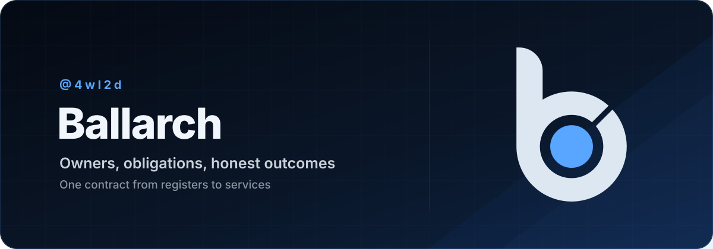

> Неканонический перевод. Нормативный и актуальный текст — [английский оригинал](../../README.md).

<h1 align="center">Ballarch</h1>

<p align="center">
  <a href="../../spec/ballarch-core-2.0.md">
    
  </a>
</p>

<p align="center">
  <strong>Владельцы, обязательства и честные исходы: одна архитектура от регистров до сервисов.</strong>
</p>

<p align="center">
  <a href="tutorial.md">Учебник</a> ·
  <a href="structure.md">Структура</a> ·
  <a href="compared-with-clean.md">Сравнение с Clean</a> ·
  <a href="levels.md">Уровни</a> ·
  <a href="ai-agents.md">Агенты</a> ·
  <a href="../../spec/ballarch-core-2.0.md">Спецификация</a> ·
  <a href="../../README.md">English</a>
</p>

**Ballarch даёт каждому эффекту одного владельца, а каждому вызову — один честный исход. Повторы, ключи идемпотентности, восстановление после падения и сверку он выносит из фич в одно проверяемое правило runtime.** Платить приходится за эффекты, а не за слои.

1. Clean Architecture определяет, от чего может зависеть код. Ballarch определяет, что код вправе утверждать о случившемся.
2. Каждый внешний вызов заканчивается исходом `Done`, `NotDone` (с доказательством) или `Unknown`. Тайм-аут после отправки вызова с эффектом — это `Unknown`, если чтение статуса не прояснило дело, и никогда не «не удалось»: заказ может уже существовать, и код обязан так и сказать.
3. Повторы, ключи, восстановление и сверку runtime выполняет один раз, по классу эффекта, объявленному для каждого порта. Экраны, сценарии использования (use cases) и обработчики этим не занимаются.
4. Нет эффектов — нет Ballarch. Один эффект — один файл. Несколько эффектов дают одно компонуемое значение знания. Одни и те же правила исходов и знания действуют везде: в регистровом блоке, в бэкенде и в вызовах инструментов ИИ-агента.

## Тайм-аут после списания

1. Пользователь нажимает **Оплатить**, и приложение отправляет `POST /orders`.
2. Сервер создаёт заказ и списывает деньги с карты.
3. Ответ теряется или приходит уже после тайм-аута клиента.
4. Клиент бросает исключение, репозиторий возвращает `Failure`, экран пишет «Оплата не прошла».
5. Пользователь снова нажимает **Оплатить**. Без ключа идемпотентности или с новым ключом на каждый запрос сервер создаёт второй заказ.
6. Каждый слой сделал свою работу. Код заявил факт, которого у него не было.

## Один Ball

В примере порты, стадии и чистый решатель лежат в одном файле, а привязка — в подпакете `app`, вне кода решателя ([раскладка по файлам](structure.md#раскладка-по-файлам)).

Из [`PlaceOrder.kt`](../../reference/kotlin/examples/place-order/src/main/kotlin/ballarch/examples/placeorder/PlaceOrder.kt):

```kotlin
/** `POST /orders` with the `Idempotency-Key` header the runtime supplies. */
val Orders = AdapterPort<Cart, Order>("orders.place", EffectClass.Idempotent)

/** `GET /orders?key=…`: the order placed with that idempotency key, or `null`. */
val OrderLookup = AdapterPort<String, Order?>("orders.lookup", EffectClass.Safe)

// ---- the request and the stages, including the one in which nobody can know yet

data class Place(val cart: Cart)

sealed interface PlaceOrderState {
    data object Idle : PlaceOrderState

    /** [repeat]: an earlier call with this [intent] ended `Unknown`. */
    data class Placing(val cart: Cart, val intent: Intent, val call: CallRef<Order>, val repeat: Boolean) : PlaceOrderState

    data class Placed(val orderId: String) : PlaceOrderState

    data class NotPlaced(val reason: String) : PlaceOrderState

    /** The server may or may not have placed the order. Placing it again repeats it with the same [intent]. */
    data class Checking(val cart: Cart, val intent: Intent) : PlaceOrderState
}

// ---- the Ball: it answers Place with the stage the order is in

object PlaceOrder : Ball<PlaceOrderState, Place, PlaceOrderState> {
    override val type = "place-order"

    override fun initial(key: String): PlaceOrderState = Idle

    override fun decide(state: PlaceOrderState, request: Place, ctx: RequestContext): Decision<PlaceOrderState, PlaceOrderState> =
        when (state) {
            Idle, is NotPlaced -> place(request.cart, ctx.newIntent(), repeat = false, ctx)
            // "Try again" after Unknown: the same order with the same intent, so the server places it at most once.
            is Checking -> if (request.cart == state.cart) place(state.cart, state.intent, repeat = true, ctx) else reject(state)
            // A double tap joins the order in flight.
            is Placing -> if (request.cart == state.cart) accept(state, state) else reject(state)
            is Placed -> accept(state, state)
        }

    private fun place(cart: Cart, intent: Intent, repeat: Boolean, ctx: Context): Decision<PlaceOrderState, PlaceOrderState> {
        val (call, send) = ctx.call(Orders, cart, timeoutMillis = 60_000, intent = intent)
        val placing = Placing(cart, intent, call, repeat)
        return accept(placing, placing, send)
    }

    override fun complete(state: PlaceOrderState, completion: Completion<*>, ctx: Context): Step<PlaceOrderState, PlaceOrderState> {
        if (state !is Placing) return step(state)
        return when (val outcome = completion.outcomeFor(state.call)) {
            is Outcome.Done -> step(Placed(outcome.value.id))
            // After an Unknown, NotDone is about this call only: the earlier one may have placed the order.
            is Outcome.NotDone -> step(if (state.repeat) Checking(state.cart, state.intent) else NotPlaced("${outcome.reason}"))
            is Outcome.Unknown -> step(Checking(state.cart, state.intent))
            null -> step(state) // a completion of another call
        }
    }
}
```

Привязка из [`PlaceOrderApp.kt`](../../reference/kotlin/examples/place-order/src/main/kotlin/ballarch/examples/placeorder/app/PlaceOrderApp.kt):

```kotlin
fun Composition.placeOrder(orders: Adapter<Cart, Order>, lookup: Adapter<String, Order?>): Composition =
    ball(PlaceOrder)
        .adapter(
            Orders, orders,
            RetryPolicy(maxAttempts = 3, backoffMillis = 1_000, attemptTimeoutMillis = 10_000),
            // The server keeps a key for 24 hours, less the time a request may still be in transit.
            dedupWindowMillis = 24 * 60 * 60 * 1_000L - ORDERS_HORIZON_MILLIS,
            reconcile = Reconciliation(
                status = OrderLookup,
                horizonMillis = ORDERS_HORIZON_MILLIS,
                statusTimeoutMillis = 5_000,
                query = { it.idempotencyKey },
                verdict = { order -> if (order != null) StatusVerdict.Applied(order) else StatusVerdict.NotApplied },
            ),
        )
        .adapter(OrderLookup, lookup)
```

Экран или обработчик отправляет `Place(cart)` через `runtime.request` и показывает стадию из `runtime.read(PlaceOrder, key)` или `watch`; ни то ни другое ничего не фиксирует ([структура](structure.md#чтение)).

### Что runtime делает за вас

- **Классификация.** Вызов, который так и не ушёл, заканчивается `NotDone`; вызов, который мог уйти, но остался без ответа, — `Unknown` ([Core §3.2](../../spec/ballarch-core-2.0.md#32-call-lifecycle)).
- **Ключи.** Все попытки вызова несут один ключ идемпотентности, а вызовы с одним намерением используют общий ключ. Поэтому «Повторить» не создаст второй заказ, пока сервер помнит ключ.
- **Повторы.** Три попытки; попытку, которая молчит 10 с, повторяют, а её поздний ответ всё равно засчитывается. На порте `NonIdempotent` композиция повторы не принимает.
- **Окно.** Вызов, который может закончиться после того, как сервер забудет его ключ, отклоняется ещё до отправки ([Core §3.5](../../spec/ballarch-core-2.0.md#35-bounds-and-preflight)).
- **Восстановление.** В профиле Durable падение не теряет ни одного вызова; вызов, который мог уйти, отправляется снова с тем же ключом, пока остаются попытки.
- **Сверка.** Если ответа нет, а попытки кончились, runtime выжидает горизонт доставки в 30 с и ищет заказ по ключу. Если и это ничего не прояснило, вызов заканчивается `Unknown`, а стадия становится `Checking`.

## Где лежит код и что код знает

| Стиль | Что определяет | Что Ballarch сохраняет | Что Ballarch добавляет | Чего стоит Ballarch |
|---|---|---|---|---|
| Clean Architecture | от чего может зависеть код | адаптеры на краю; путь чтения | классы эффекта, три исхода, один runtime для повторов, ключей и восстановления | runtime; именованная стадия на каждый шаг |
| Гексагональная | внутренняя часть владеет своими портами | порты и адаптеры | приложение объявляет класс каждого порта; адаптеры никогда не повторяют вызовы | адаптеры должны честно сообщать доказательства |
| MVI, Elm, TCA | чистый редьюсер; эффекты как значения | чистый решатель | фиксация до любого эффекта; одно типизированное завершение на вызов | сериализуемое состояние в профиле Durable |
| Акторы | один владелец, одно сообщение за раз | единственный владелец | атомарная фиксация состояния и выходов; одно завершение на вызов | фиксация на каждом шаге |
| Движки durable execution | прогресс переживает падение | долговечный прогресс и таймеры | исходы по классу порта; восстановление без повторного запуска кода; знание | явные стадии; runtime и хранилище вы размещаете сами, без интерфейса эксплуатации и масштабирования воркеров |

Аккуратный код в любом из этих стилей справится со сбоем, описанным выше: в каждой фиче отдельно или в общем хелпере команды, о котором каждая фича должна помнить. Ballarch помещает эту обработку в один runtime с письменным контрактом и тестами соответствия и делает `Unknown` типом. В [сравнении с Clean](compared-with-clean.md) одна и та же фича построена обоими способами.

## Лестница эффектов

- **Ступень 0.** Ни одного вызова на портах `Idempotent` или `NonIdempotent`: обычный код.
- **Ступень 1.** Один эффект, который может повториться, например отправка формы: один Ball в одном файле. Пять понятий: Ball и решатель, порт и класс эффекта, три исхода, намерение, корень композиции.
- **Ступень 2.** Несколько вызовов с эффектом, например резервирование и списание: *Flow*, то есть Ball, состояние которого — весь многошаговый процесс. В профиле Durable он заявляет значение знания ([Core §4.2](../../spec/ballarch-core-2.0.md#42-knowledge-of-composite-operations)).

**Не Ball** ([Core §1](../../spec/ballarch-core-2.0.md#1-scope)): экраны и ViewModel, репозитории, сценарии использования, кэши и пагинация, мапперы, сервисы без состояния, навигация, `Safe`-чтения, а также запись, которая укладывается в одну транзакцию той базы данных, где хранится её состояние. Если кому-то из них нужен вызов с эффектом, этот вызов переезжает в Ball.

## Пять гарантий

Соответствующий спецификации runtime с соответствующими ей адаптерами даёт гарантии 2–4 по построению для заявленного профиля, если объявленные классы эффектов и горизонты доставки соответствуют действительности. Гарантиям 1 и 5 нужны ещё и [правила для автора](../../spec/ballarch-core-2.0.md#51-author-rules).

1. **Один владелец.** У каждой части управляемого состояния один владелец, и меняет он её только фиксацией своих решений.
2. **Ничто не уходит раньше времени.** Ни один эффект не запрашивается до того, как зафиксировано его решение.
3. **Один честный исход.** Каждый вызов заканчивается ровно один раз, никогда не утверждая, что ничего не произошло, если что-то могло произойти.
4. **Решения не расщепляются.** Падение сохраняет состояние решения и запросы вместе — или не сохраняет ни того, ни другого.
5. **Без преувеличений.** Утверждение о нескольких вызовах никогда не говорит больше, чем дают их исходы; завершённая составная операция, удовлетворяющая [Core §7.4](../../spec/ballarch-core-2.0.md#74-composition-closure), отвечает как один вызов.

## Где это применимо

- **Мобильные приложения:** отправка форм, платежи и офлайн-очереди; экран никогда не показывает `Unknown` как ошибку. [Структура](structure.md), [честный интерфейс](honest-ui.md).
- **Бэкенд:** Ball на каждый ключ агрегата, и в каждый момент им владеет один runtime. Между серверами распределяйте ключи по партициям сами и берите хранилище, которое отсекает записи (fencing; в эталоне такого нет). Flow заменяют саги, написанные вручную. [Структура](structure.md).
- **Прошивки и драйверы:** горизонт отправки — запуск передачи или запись в doorbell-регистр; сброс после отправки оставляет вызов в состоянии `Unknown`. [Уровни](levels.md), [эталон на C](../../reference/c/).
- **RTL:** `always_comb` решает, фронт тактового сигнала фиксирует, `valid && ready` отправляет. [Уровни](levels.md), [эталон RTL](../../reference/rtl/).
- **ИИ-агенты:** инструменты — это порты с объявленными классами. Модель предлагает, вызовы делает детерминированный код, а статус в отчёте берётся из исходов этих вызовов, а не из ответа модели. [Агенты](ai-agents.md).

Эталон на Kotlin работает только на JVM и не опубликован, поэтому его нужно собирать из исходников. В нём нет модуля Android, мобильного хранилища и тестов на устройстве. [Привязки](bindings.md) показывают, как перенести его на Android, и дают наброски для Swift, Rust и TypeScript без заявления о соответствии.

## Что здесь нового, а что нет

Родословная: сущности Хелланда ([Helland 2007](https://www.cidrdb.org/cidr2007/papers/cidr07p15.pdf), дата обращения: 2026-10-27) с исполняемым контрактом исходов, плюс алгебра того, что может утверждать многошаговая операция. Насколько автору удалось установить, нового здесь четыре вещи ([Core §12](../../spec/ballarch-core-2.0.md#12-lineage-and-what-is-new-informative)):

1. **Составное знание** (главное заявление): значение (all, any) в трёхзначной логике Клини. Оно не зависит от порядка вызовов, считает отменой только поглощающие компенсации, вкладывается одно в другое и возвращается как ответ завершённой операции. Структура классическая; новое — её применение.
2. **Одно правило исходов для всех портов**, которое обеспечивает runtime: новое сочетание уже существующего правила.
3. **Ключи, окна и сверка в runtime** — скромное сочетание.
4. **Одни и те же правила исходов и знания на трёх уровнях** — узкое сочетание: структурные правила на уровнях различаются, а сами уровни друг с другом не компонуются.

Не новы: единственный владелец, чистые решатели, фиксация до отправки, три исхода и адаптеры на краю.

## Проверки, которые можно запустить

Каждое число проверяется утверждением в названном тесте, если оно не помечено как печатаемое. Все проверки перечислены в [приложении F](../../spec/ballarch-core-2.0.md#appendix-f-checks-and-evidence-in-the-reference-implementations-informative).

| Проверка | Результат |
|---|---|
| [`PlaceOrderTest`](../../reference/kotlin/examples/place-order/src/test/kotlin/ballarch/examples/placeorder/PlaceOrderTest.kt) | При потерянных запросах, потерянных ответах, отказах в соединении и падении ни один заказ не создаётся дважды, а `NotPlaced` бывает, только если заказ не создан. После трёх потерянных ответов «Повторить» отправляет четвёртую попытку с тем же ключом, и создаётся один заказ; через неделю такой повтор отклоняется и ничего не отправляется. |
| [`KnowledgeTest`](../../reference/kotlin/ballarch-kernel/src/test/kotlin/ballarch/kernel/KnowledgeTest.kt), [`test_knowledge.c`](../../reference/c/test/test_knowledge.c) | Алгебра корректна и покоординатно точна на 69 905 мирах (Kotlin, C) и на 127 551 мире с двумя попытками компенсации (Kotlin). |
| [`TripFlowTest`](../../reference/kotlin/examples/trip/src/test/kotlin/ballarch/examples/trip/TripFlowTest.kt) | 6438 прогонов при всех судьбах вызовов и во всех точках падения: ни одно утверждение не противоречит бронированиям; двузначный статус ошибается в 1190 из них. |
| [`ItineraryFlowTest`](../../reference/kotlin/examples/itinerary/src/test/kotlin/ballarch/examples/itinerary/ItineraryFlowTest.kt) | Flow из двух Flow: ни одного ложного утверждения ни в 130 321 прогоне без падения, ни в 29 774 прогонах со сбоями и точкой падения (в 28 933 из них падение произошло). |
| [`ExplorationTest`](../../reference/kotlin/ballarch-runtime/src/test/kotlin/ballarch/runtime/ExplorationTest.kt) и соседние тесты | Все сценарии и граничные случаи приложения E к Core; прогоны из перебора сверяются с тем, что произошло на самом деле. |
| [`RuntimeTest`](../../reference/kotlin/ballarch-runtime/src/test/kotlin/ballarch/runtime/RuntimeTest.kt) | Вызов с эффектом, получивший ответ `Done`, стоит трёх долговечных записей; чтения не стоят ни одной. |
| [Прошивка](../../reference/c/) | 937 229 и 982 599 прогонов двух контроллеров при отключениях питания, сбоях NVM и сбоях связи: нарушений нет (границы по умолчанию). |
| [RTL](../../reference/rtl/) | Все проверки тестбенчей проходят (8764 сценария на каждый набор параметров и 1458; числа печатают `tb_issuer.sv` и `tb_composite.sv`). |
| [Alloy](../../formal/alloy/) | P1–P6 и L1 выполняются в пределах границ модели; для каждой из шести внесённых ошибок находится контрпример. |

Нужны JDK 21, Python 3.8 или новее, gcc или clang, Icarus Verilog, Verilator и Yosys:

```sh
(cd reference/kotlin && ./gradlew build checkModuleBoundaries)
python3 tools/oracles.py reference/kotlin/ballarch-runtime/build/conformance-traces/*.jsonl
python3 tools/oracles.py --expect-violations reference/kotlin/ballarch-runtime/build/conformance-traces/seeded/*.jsonl
make -C reference/c
make -C reference/rtl
bash formal/alloy/fetch-alloy.sh && python3 formal/alloy/run.py
```

Проверки каждого уровня обязаны ловить и внесённые ошибки. CI запускает все эти команды, кроме команды для трасс с внесёнными нарушениями; эти трассы проверяет сборка Kotlin с помощью `tools/oracles.py` (`TraceConformanceTest`).

## Цена и ограничения

По [Core §10](../../spec/ballarch-core-2.0.md#10-trade-offs-and-known-limitations):

- **Записи.** В профиле Durable вызов с эффектом требует трёх долговечных записей, плюс одной на каждый повтор и одной при переходе к сверке.
- **Один писатель на ключ:** горячий ключ превращается в очередь.
- **Явные стадии,** сериализуемые в профиле Durable, а также runtime и хранилище, которые нужно где-то размещать.
- **Не проверяется:** объявленные классы эффекта, окна и горизонты доставки; завершаемость решателя, честность адаптеров сверх проверок адаптеров, поглощающий характер компенсаций, границы владения и вызовы между уровнями.
- **Инварианты, охватывающие несколько Ball,** требуют координирующего Ball, резервирования или ограничения в базе данных.

Ballarch не подходит для кода без состояния, CRUD в одной транзакции, консенсуса и циклов, которые не могут позволить себе фиксацию на каждый вход. Он не делает никаких измеренных утверждений о продуктивности, объёме кода или успешности агентов. См. [руководство по выбору](decision-guide.md).

## Навык для агентов

[`skills/ballarch/`](../../skills/ballarch/) — навык (skill) для агента, который пишет код, меняющий состояние через вызовы, а такой вызов может не пройти или сработать дважды. Навык проверяет, подходит ли Ballarch к задаче, заставляет агента объявлять классы портов и обрабатывать все три исхода, а также запрещает циклы повторов, придуманные ключи и тайм-ауты, выданные за ошибки. Эталонный код есть только у его шаблонов на Kotlin и C. Скопируйте каталог вместе с `LICENSE` и `NOTICE.md` в каталог навыков вашего агента под именем `ballarch` ([формат Agent Skills](https://agentskills.io/specification), дата обращения: 2026-10-27).

**Пока не оценён:** нет результатов, которые показывали бы, что он помогает.

## Карта репозитория

| Путь | Содержимое |
|---|---|
| [`spec/`](../../spec/ballarch-core-2.0.md) | Нормативная спецификация |
| [`reference/kotlin/`](../../reference/kotlin/README.md) | Ядро, runtime, тестовый набор, архитектурные правила, примеры |
| [`reference/c/`](../../reference/c/) | Runtime для прошивок (C11) |
| [`reference/rtl/`](../../reference/rtl/) | Аппаратные Ball (SystemVerilog) |
| [`formal/alloy/`](../../formal/alloy/) | Модель протокола вызовов на Alloy |
| [`tools/`](../../tools/) | [Формат трасс](../../tools/TRACE-FORMAT.md) и программа проверки |
| [`docs/`](../) | Руководства |
| [`docs/ru/`](README.md) | Русское издание для чтения (ненормативное) |
| [`skills/ballarch/`](../../skills/ballarch/) | Навык для агентов |

До Core 1.5 включительно Ballarch назывался Pokeball ([миграция](migration-from-1.5.md)). См. также [CONTRIBUTING.md](../../CONTRIBUTING.md) и [CITATION.cff](../../CITATION.cff).

## Лицензия и авторство

Copyright © 2026 **Vladislav Tomilov (4wl2d)**.

Текст и диаграммы распространяются по лицензии [CC BY 4.0](../../LICENSE); см. [NOTICE.md](../../NOTICE.md). **У кода пока нет лицензии на программное обеспечение.** Выбор такой лицензии остаётся за правообладателем. Ballarch не связан с Nintendo; прежнее название проекта не используется как товарный знак.

Ballarch Architecture by Vladislav Tomilov (4wl2d).
