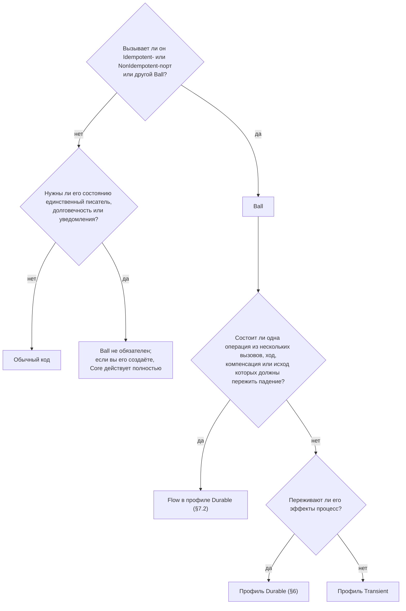

> Неканонический перевод. Нормативный и актуальный текст — [английский оригинал](../decision-guide.md).

# Руководство по выбору: когда Ballarch окупается

У Ballarch есть порог. Код, который не вызывает ничего, что может сработать дважды, остаётся обычным кодом, и Core его не ограничивает. Выше порога компонент, который запрашивает такой эффект, становится Ball. Это руководство помогает принять решение для каждого компонента, а затем для проекта. В нём перечислены издержки, которые вытекают из устройства Ballarch; это не результаты измерений. Ни одно исследование не сравнивает Ballarch с другой архитектурой.

## Нужен ли Ball?

Границу проводит [Core §1](../../spec/ballarch-core-2.0.md#1-scope). Компоненту нужен Ball, когда он запрашивает эффекты, исход которых может оказаться неопределённым: вызывает Idempotent- или NonIdempotent-порты, в том числе другие Ball. Порт, класс которого вы не установили, считается NonIdempotent ([Core §2.6](../../spec/ballarch-core-2.0.md#26-declaring-effect-classes)).

**Легенда.** Ромбы — вопросы об одном компоненте, прямоугольники — ответы. Ball в профиле Transient, эффекты которого переживают процесс, может вместо этого передавать ключ операции в своём запросе ([Core §7.2](../../spec/ballarch-core-2.0.md#72-workflows)).

К обычному коду относятся:

- отрисовка и состояние UI, ввод в формы, фокус и прокрутка;
- навигация;
- производные значения, мапперы и DTO, сервисы без состояния;
- кэши, модели чтения и пагинация поверх данных, которыми владеет кто-то другой;
- вызовы Safe-портов, например поиск или чтение статуса;
- записи, единственный эффект которых — одна транзакция в хранилище, где лежит их состояние, например CRUD в одной базе данных.

Код, который вызывает Idempotent- или NonIdempotent-порт вне Ball, не покрыт гарантиями Core, и никакое утверждение не может его охватывать ([Core §9.5](../../spec/ballarch-core-2.0.md#95-claims)).

Ответы складываются в лестницу:

- **Ступень 0: обычный код.** Нет эффектов — нет Ballarch.
- **Ступень 1: один Ball, один файл.** Один эффект, например оформление заказа. [Пример `place-order`](../../reference/kotlin/examples/place-order/) держит порты, стадии и Ball в одном файле, а привязку — в подпакете `app`.
- **Ступень 2: Flow со знанием, в профиле Durable.** Несколько эффектов, которые образуют одну операцию, например рейс и отель. Ответ Flow несёт одно значение знания ([Core §4.2](../../spec/ballarch-core-2.0.md#42-knowledge-of-composite-operations)). Примеры с поездкой ([trip](../../reference/kotlin/examples/trip/)) и маршрутом ([itinerary](../../reference/kotlin/examples/itinerary/)) — это Flow.

[Структура приложения](structure.md) показывает, где хранить каждый вид состояния.

## Чем вы платите

Эти издержки вытекают из устройства архитектуры ([Core §10](../../spec/ballarch-core-2.0.md#10-trade-offs-and-known-limitations)).

- **Долговечные записи.** В профиле Durable вызов с эффектом требует трёх долговечных записей: фиксации, которая его запрашивает, его упреждающей записи (write-ahead) и фиксации его завершения. `RuntimeTest` проверяет это для одного вызова с ответом `Done`. Каждый повтор добавляет ещё одну упреждающую запись, а переход к сверке — ещё одну запись. Чтение не требует ни одной.
- **Один писатель на экземпляр.** Горячий ключ обрабатывается по одному шагу за раз.
- **Планирование.** На выделенном цикле каждый вход стоит передачи между потоками. Если шаг выполняется в потоке, который отправил вход, такой передачи нет.
- **Явные стадии.** Каждая стадия операции — вариант состояния Ball, сериализуемый в профиле Durable. Среди них есть стадия «пока никто не знает», которую интерфейс должен показать.
- **Зависимости.** Runtime и, в профиле Durable, хранилище, которое соответствует контракту хранилища ([Core §6](../../spec/ballarch-core-2.0.md#6-profiles)). Эталонный runtime написан на Kotlin/JVM. Его файловое хранилище блокирует свой каталог на одном хосте и не реплицируется. Нескольким хостам нужно хранилище, которое отсекает записи (fencing) ([R16](../../spec/ballarch-core-2.0.md#52-runtime-rules)).
- **Дисциплина развёртывания.** В профиле Durable развёртывание застаёт открытые обязательства. Изменённая форма состояния требует версии и миграции. Порт, тип Ball или подписку, у которых остались открытые вызовы или уведомления, нужно сначала довести до закрытия (drain) и только потом удалять при развёртывании, иначе runtime откажется стартовать ([Core §6.1](../../spec/ballarch-core-2.0.md#61-evolution)).
- **Объявления, которые ничто не проверяет.** Классы эффекта, окна дедупликации и горизонты доставки берутся из контракта каждого получателя. Честность адаптера сверх проверок адаптеров, поглощающие компенсации и границы владения остаются на ревью.
- **Новые понятия.** Ball с решателем, порт с классом эффекта, три исхода, намерение (intent) и привязка в корне композиции. Flow добавляют значение знания.

## Что вы получаете

[Core §1](../../spec/ballarch-core-2.0.md#1-scope) перечисляет пять свойств. Runtime, соответствующий Core, вместе с соответствующими адаптерами даёт три средних свойства по построению — для того профиля, который он заявляет, при условии, что каждый объявленный класс эффекта верен ([Core §2.6](../../spec/ballarch-core-2.0.md#26-declaring-effect-classes)), а каждый получатель, с которым проводится сверка, соблюдает объявленный для него горизонт доставки ([Core §10](../../spec/ballarch-core-2.0.md#10-trade-offs-and-known-limitations)). Первое и последнее требуют ещё и Ball, которые следуют правилам для автора ([Core §5.1](../../spec/ballarch-core-2.0.md#51-author-rules)).

1. **Один владелец.** У каждой части изменяемого состояния, которую регулирует Core, ровно один владелец, и он меняет её только фиксацией собственных решений. *Требует правил для автора.*
2. **Ничего не уходит раньше времени.** Ни один эффект не запрашивается до того, как зафиксировано решение, которое его запрашивает. *По построению, если объявления верны.*
3. **Один честный исход на вызов.** Каждый вызов заканчивается `Done`, `NotDone` или `Unknown` и никогда не утверждает, что ничего не произошло, если что-то могло произойти. *По построению, если объявления верны.*
4. **Решения не расщепляются.** Падение никогда не расщепляет решение: изменение состояния и запрошенные эффекты фиксируются вместе или не фиксируются вовсе. *По построению, если объявления верны.*
5. **Никаких утверждений сверх доказательств.** Утверждение об операции из нескольких вызовов никогда не говорит больше, чем устанавливают их исходы. Flow, который отвечает после завершения операции, отвечает как один честный вызов на любой глубине ([Core §7.4](../../spec/ballarch-core-2.0.md#74-composition-closure)). *Требует правил для автора.*

Кроме того, runtime один раз для всех портов делает то, что иначе каждая фича делает сама ([Core §3.2](../../spec/ballarch-core-2.0.md#32-call-lifecycle)):

- классифицирует каждый исход по классу эффекта, записанному вместе с вызовом;
- выводит ключи идемпотентности и даёт один ключ всем вызовам, которые называют одно намерение;
- повторяет вызовы Safe- и Idempotent-портов в пределах их бюджета и тайм-аута попытки и отклоняет политику повторов на NonIdempotent-порте;
- отклоняет вызов, который закончился бы за пределами объявленного окна дедупликации его порта;
- в профиле Durable восстанавливает открытые вызовы после перезапуска;
- опционально сверяет вызов без ответа через порт статуса после горизонта доставки.

Эталонная сборка проверяет часть правил: чистоту решателя и границы модулей, отказы композиции, перебор сбоев и падений с проверкой по фактическому состоянию и программу проверки трасс, которой может пользоваться runtime на любом языке. Остальное остаётся на ревью ([приложение F](../../spec/ballarch-core-2.0.md#appendix-f-checks-and-evidence-in-the-reference-implementations-informative)).

## Когда применять

- **Платежи, отправка заказов и форм, бронирования.** Дубликат стоит денег, а «не удалось» после списания отправляет пользователя платить ещё раз ([сравнение с Clean](compared-with-clean.md)).
- **Синхронизация и офлайн-очереди.** Запрос может ждать, повторяться или пережить ключ, который хранит сервер.
- **Команды устройствам.** Команда исполнительному механизму, запись в doorbell-регистр или в FIFO, которая не должна повториться ([уровни](levels.md)).
- **Вызовы инструментов ИИ-агентами.** Вызов инструмента, который что-то меняет, и итоговый отчёт, который не должен утверждать больше, чем произошло ([агенты](ai-agents.md)).
- **Много авторов.** Такие фичи пишут несколько людей или агентов, и вам нужно одно правило исходов вместо отдельного в каждой фиче.

## Лучше выбрать другое, когда

- **Код без состояния или это интерфейс.** Он остаётся обычным кодом (§1).
- **Запись — это CRUD в одной транзакции базы данных.** База уже делает её атомарной.
- **Один ключ требует многих одновременных писателей.** Один писатель на экземпляр превращает горячий ключ в очередь.
- **Состоянию нужен консенсус или репликация между узлами.** Core их не определяет (§1).
- **Контур управления не может позволить себе фиксацию на каждый вход.** Оставьте контур обычным кодом, а Ballarch применяйте только к команде исполнительному механизму.
- **Инвариант охватывает нескольких владельцев и должен соблюдаться атомарно.** Одно решение не может его обеспечить. Используйте базу данных, резервирование или координирующий Ball.
- **Конвейером уже владеет транзакционный потоковый обработчик.** Если он фиксирует состояние и вывод вместе, Ball внутри него дублирует этот журнал.
- **Это разовый скрипт.** Человек следит за исходом, и восстанавливать нечего.
- **У вас уже работает движок durable execution.** Прежде чем добавлять второй контракт runtime, сравните его гарантии с тем, что нужно вашему приложению (см. [FAQ](faq.md)).
- **Процессов с эффектами немного, и ими владеют люди, которые знают, как они отказывают.** Аккуратный код, написанный вручную, может быть так же корректен; Ballarch переносит эту заботу в один runtime, и цена этого — сам runtime.

## Пока неизвестно

Это не измерялось. Не стоит делать предположений ни в одну сторону.

- Справляются ли агенты-программисты лучше с Ballarch. Навык для агентов не оценивался.
- Меняет ли Ballarch продуктивность, трудозатраты на ревью, онбординг или число дефектов в команде.
- Как он компонуется между уровнями: ни один эталон не соединяет сервис с прошивкой или аппаратурой ([Core §11](../../spec/ballarch-core-2.0.md#11-interpretation-across-levels-informative)).
- Как он ведёт себя с продакшен-хранилищем, в реальной сети и под продакшен-нагрузкой.
