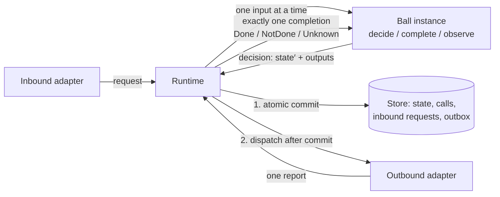
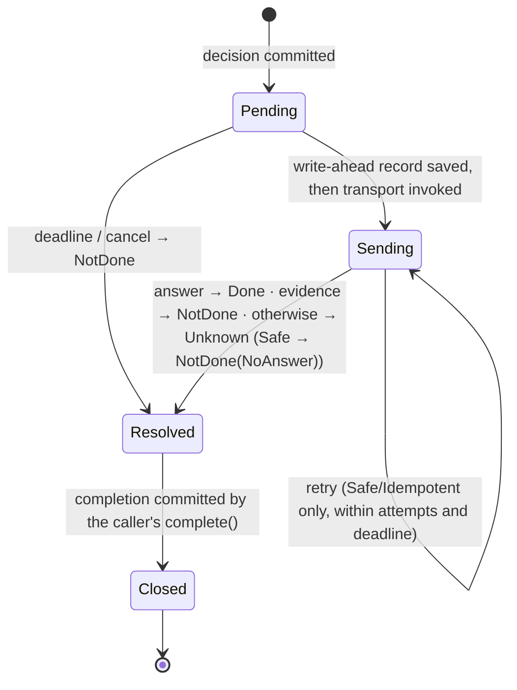
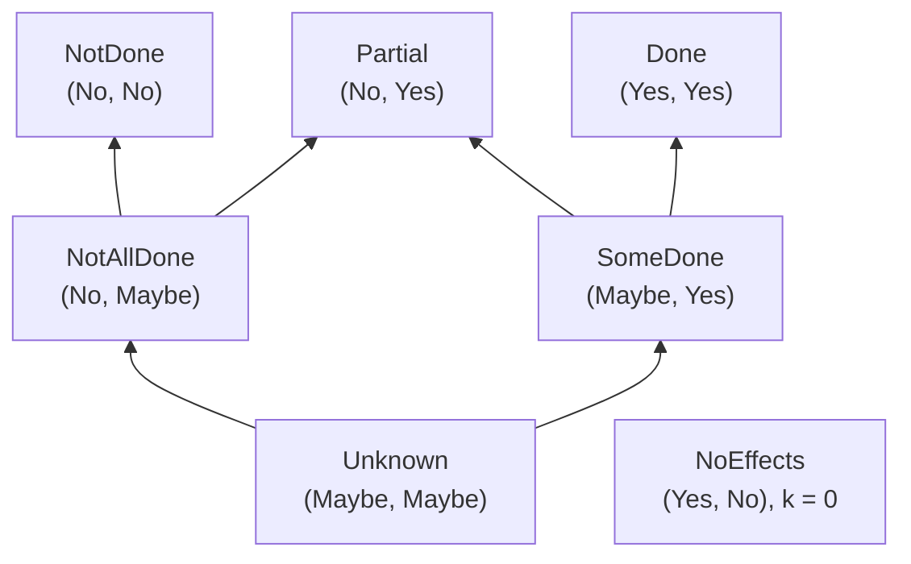

# Ballarch Core 2.0 — Specification

| | |
|---|---|
| **Version** | `2.0.0-rc.1` |
| **Status** | Release candidate for public review. Before `2.0.0`, normative text changes only to correct errors or omissions found in review. |
| **Date** | 2026-10-27 |
| **Supersedes** | Pokeball Core `1.5.0-draft`, published under the project's former name ([published version](https://github.com/4wl2d/Pokeball/tree/1bb9e0ecca4d4d1c8b39327c93988c1b490f303e)); mapping in [`docs/migration-from-1.5.md`](../docs/migration-from-1.5.md) |
| **Reference implementations** | services: [`reference/kotlin/`](../reference/kotlin/) (Kotlin/JVM); firmware: [`reference/c/`](../reference/c/) (C11); hardware: [`reference/rtl/`](../reference/rtl/) (SystemVerilog) |
| **Formal models** | call protocol: [`formal/alloy/obligations.als`](../formal/alloy/obligations.als); knowledge algebra: exhaustive checks in [`KnowledgeTest`](../reference/kotlin/ballarch-kernel/src/test/kotlin/ballarch/kernel/KnowledgeTest.kt) (Kotlin) and [`test_knowledge.c`](../reference/c/test/test_knowledge.c) (C) |
| **Conformance** | Normative: Appendices C–E and trace format v1 ([`tools/TRACE-FORMAT.md`](../tools/TRACE-FORMAT.md)); reference checker [`tools/oracles.py`](../tools/oracles.py). |

## 0. How to read this document

Sections 2–7 are **normative**, except for examples, the 'Standard analogue' column of §2, parts marked *informative*, and reported results of checks, such as those in §4.1. Section 8 is **guidance**: recommended practice that a conforming system may ignore with reason. Section 9 defines **conformance**. Sections 1, 10, 11 and 12 are informative.

The key words MUST, MUST NOT, SHOULD, SHOULD NOT and MAY are to be interpreted as described in RFC 2119 and RFC 8174 when, and only when, they appear in capitals.

Appendices C, D and E are normative. Appendix F lists the checks and results in the reference implementations and is informative, as is every statement about what the references do.

## 1. Scope

Ballarch Core specifies how the **stateful components** of a system decide, change their state, and interact with each other and with external systems, such that the following hold in a conforming system (§9):

1. every piece of mutable state that Core governs has exactly one owner, which changes it only by committing its own decisions;
2. no external effect is requested before the decision that requests it is committed;
3. every outbound request ends in exactly one terminal outcome, and that outcome never claims that nothing happened when something may have happened;
4. a crash never splits a decision: its state change and its requested effects are committed together or not at all;
5. a statement about an operation made of several requests never claims more than the outcomes of those requests establish; an owner that answers for such an operation once it is settled offers its caller what a single request offers: one completion, and no claim stronger than the evidence (§7.4).

A conforming runtime with conforming adapters guarantees properties 2–4 by construction for the profile it claims, provided that each declared effect class is correct (§2.6) and each reconciled destination keeps its declared delivery horizon (§3.2, §10). Properties 1 and 5 also need Balls that follow the author rules (§5.1); the references check those partly with tools and partly by review (Appendix F).

The rules apply at any level with owned state and fallible interactions: a hardware block on a bus, firmware that drives a device, an in-memory UI component, a durable backend service, a workflow across services. The commit and outcome rules (R4–R8) and the knowledge rule (R14) are the same at every level. Which structural rules apply, and how they are checked, depends on the elements a level has (§9.4, §11).

**Non-goals.** Ballarch Core does not specify: distributed consensus or replication of a Ball across nodes; exactly-once execution of external effects (only mechanisms that make at-most-once or effectively-once achievable); multi-Ball transactions; a wire format; a UI toolkit; a navigation model; offline merging of concurrent edits; security isolation between Balls in one process; or a deployment topology.

**Where Core applies.** Core governs Balls. A component needs a Ball when it requests effects whose outcome can be uncertain: calls on Idempotent or NonIdempotent ports, including calls to other Balls. A team may also make a Ball of state without such calls, for single-writer serialisation, durability or notices; Core then applies to it in full. Everything else is plain code that Core does not constrain. That includes rendering and UI state, navigation, derived values, caches of data another owner holds, calls on Safe ports, stateless transformations, and writes whose only effect is one transaction in the store that holds their state. Code that calls an Idempotent or NonIdempotent port outside a Ball is outside Core's guarantees, and no claim under §9.5 may cover it.

## 2. Model

| Term | Definition | Standard analogue |
|---|---|---|
| **Ball** | A single-writer owner of state, addressed by a `BallId` = (type, key). A Ball *type* is defined by a decider; an *instance* by its key. | aggregate (DDD), actor, entity, grain (Orleans) |
| **Decider** | The pure functions of a Ball type: `initial(key)`, `decide(state, request, ctx)`, `complete(state, completion, ctx)`, `observe(state, notice, ctx)`. | Decider (Chassaing), reducer, Elm `update` |
| **Runtime** | Executes Balls: serialises their inputs, invokes deciders, commits decisions, dispatches outputs, tracks obligations. | actor runtime, effect interpreter, "imperative shell" |
| **Port** | A typed request/response contract with an **effect class**, owned by its destination. An *adapter port* is implemented by an adapter; a *Ball port* is served by another Ball. | port (Ports and Adapters) |
| **Adapter** | Code outside every decider that performs requests on an adapter port (outbound) or turns external input into requests (inbound). | adapter (Ports and Adapters), gateway |
| **Effect class** | `Safe` (neither a repeat nor an omission changes the destination), `Idempotent` (the destination deduplicates deliveries that carry the same idempotency key), `NonIdempotent` (each delivery may take effect). | RFC 9110 safe and idempotent methods |
| **Intent** | A runtime-issued identity for one effect that a Ball may request more than once; calls naming it carry one idempotency key (§3.2). | idempotency key per operation (Stripe) |
| **Composition root** | The one place that lists Ball types, binds adapters to ports, and declares subscriptions. | composition root (dependency injection) |
| **Profile** | What survives a crash: `Transient` or `Durable`. | — |
| **Horizon** | One of two instants that every call crosses in order: the *commit horizon* and the *send horizon* (§2.5). | commit point; output commit; point of no return |
| **Knowledge** | What is established about whether an operation made of several calls took effect (§4.2). | heuristic outcome (XA), `:info` (Jepsen) |



**Legend.** Boxes are components; arrows are the order of operations in one step (§3.1). Deciders never touch the store or adapters; only the runtime does.

### 2.1 Messages

**Inputs** (what a decider receives):

| Input | Meaning | Decider function |
|---|---|---|
| **Request** | Asks the Ball to do something. May be rejected. | `decide` |
| **Completion** | The single terminal outcome of a call this instance made. Cannot be rejected. | `complete` |
| **Notice** | A publication from a subscribed topic. | `observe` |

**Outputs** (what a decision asks the runtime to do after committing it):

| Output | Meaning |
|---|---|
| **Call**(key, port, request, timeout[, target][, intent]) | Ask a port to perform a request, optionally naming an intent (§3.2). Opens an *obligation*. |
| **Reply**(requestId, value) | Answer an earlier accepted request whose reply was deferred. |
| **Publish**(topic, payload) | Publish a notice to the subscribers declared for the topic. |
| **Cancel**(key) | Ask to cancel an open call. |

A `decide` returns **Accept**(state, reply plan, outputs) or **Reject**(reason). The reply plan is *now* (a value) or *later* (a `Reply` output in a later decision). `complete` and `observe` return **Step**(state, outputs).

### 2.2 Outcomes

Every call and every external request ends in exactly one **Outcome**:

| Outcome | Asserts |
|---|---|
| **Done**(value) | The destination processed the request and answered `value`. `value` may itself describe a business refusal that the destination recorded. |
| **NotDone**(reason) | There is evidence that the request had no effect. |
| **Unknown**(reason) | The request may or may not have taken effect. |

A Ball that receives a request answers its caller as follows (§3.3):

| The destination | The caller receives | Effect | A repeat with the same identity |
|---|---|---|---|
| refused it without committing anything: a Ball's `Reject`, a bound, a fault | `NotDone(Refused(reply))`, `NotDone(Overloaded)`, `NotDone(Fault)` | none | is decided again |
| accepted it and recorded an answer, possibly a business refusal (`Accept`) | `Done(reply)` | what the reply says | receives the same reply (§3.3) |

A call on a Safe port never completes `Unknown`. A language binding SHOULD give such completions a type that admits only `Done` and `NotDone`.

### 2.3 Context

A decider receives a **context** supplied by the runtime. It holds the instance's `BallId`, the current time (`now`), the revision the decision will commit as, a deterministic generator of call keys, and a generator of intents (§3.2). For a request, it also holds the request identity and the caller: another Ball, or an external principal authenticated by an inbound adapter.

### 2.4 Time

A decider reads time only from the context and waits only by calling the built-in **timer port** (Safe), which every conforming runtime binds. The references and conformance traces name this port (§9.6, Appendix F). A timer call's request is a `delay`; its *due time* is the commit time plus `delay`. Its timeout is `delay` plus a fixed margin of the runtime (1 s in both references), so its deadline is the due time plus that margin. The runtime's timer constructor makes such a call. A timer:

- completes `Done` at its due time, and never before it unless cancelled;
- cancelled before it fires, completes `NotDone(NotApplied)`; cancelled while still `Pending`, `NotDone(Cancelled)`;
- under the Durable profile, survives a restart: it is re-armed to its original due time, or completes `NotDone(NoAnswer)` if the restart comes after its deadline.

A completion of a timer is a wake-up, not a fact about the world: a decider that must not act before some time SHOULD keep that time in its state and compare it with `now`.

### 2.5 Boundaries in time

Architectures usually draw their boundaries in space: layers, modules, services, the hexagon's ports. Ballarch also draws two boundaries in time. Every call crosses them in this order:

| Horizon | The instant | Before it | After it | Rules |
|---|---|---|---|---|
| **Commit horizon** | The atomic commit of the decision that requests the call | The call is part of a decision that can still vanish. Nothing may leave. | The call is an obligation: it will get exactly one outcome, and under the Durable profile it survives crashes. | R4, R5, R6 |
| **Send horizon** | The first moment the request may have left the runtime | The call can be withdrawn truthfully: `NotDone`. | The outcome is `Done`; `NotDone` only with evidence covering every attempt, or for a Safe port (R7); otherwise `Unknown`. | R7, R8 |

Between the horizons a call is `Pending`; after the send horizon it is `Sending` (§3.2). The horizons mark where knowledge about an effect changes kind. Before the commit horizon there is nothing to know; between them, non-occurrence can still be proved. After the send horizon, an effectful call's non-occurrence needs evidence about every attempt or later reconciliation.

An implementation MUST make each horizon an event that its checks can observe. Under the Durable profile, these events are the commit record and the write-ahead record of §3.2. In a synchronous circuit, they are the clock edge that commits the request and the first cycle from which the bus no longer lets it be withdrawn: the `valid && ready` handshake or, on AXI, the assertion of VALID (§11).

### 2.6 Declaring effect classes

A port's effect class is a property of its destination, declared in code the application owns: the composition root for adapter ports. A destination's description of itself, such as a tool annotation, an interface definition or a device descriptor, informs that declaration and never replaces it. A port whose class has not been established MUST be declared NonIdempotent. An access that changes the destination by reading it is not Safe: a read that clears a register, pops a FIFO or acknowledges an interrupt is NonIdempotent unless the device deduplicates it.

## 3. Execution semantics

This section defines the observable behaviour of a conforming runtime. A runtime MAY implement it differently if no observer (decider, adapter, requester, or durable store after a crash) can tell the difference.

### 3.1 The instance step

Each Ball instance has an inbox. The runtime repeatedly takes one input from one instance and performs one **step**:

```text
1. input  ← dequeue(instance.inbox)
2. result ← decider function for the input kind (state, input, context)
3. check  ← preflight(result)            # §3.5: bounds, keys, replies, bound ports
4. if the result is Reject, a failed check, or a decider fault:
       commit nothing; answer a request with NotDone(…); a faulty completion/notice quarantines the instance
   else:
       commit(state′, new calls as Pending, replies, notices)   # one atomic write
5. dispatch: deliver replies, publish notices, start pending calls   # only after 4 succeeded
```

Steps of one instance never overlap or nest. A runtime MAY run a step on the thread or task that submits its input, provided an input submitted during a step or its dispatch is processed only after that step. Whether steps run inline or on a dedicated loop is an implementation choice, not a profile. Steps of different instances MAY run concurrently if every rule in §5 still holds per instance.

### 3.2 Call lifecycle

A call is identified by `(caller BallId, key)`. Its lifecycle is:



**Legend.** Arrows are runtime transitions of one call. `Pending` and `Sending` are durable phases under the Durable profile; `Resolved` is the runtime's choice of outcome, not yet seen by the decider; `Closed` means the caller committed the completion. A reconciled port adds the phase `Reconciling` between `Sending` and `Resolved` (below).

Classification when a call resolves:

| Situation | Safe | Idempotent | NonIdempotent |
|---|---|---|---|
| Destination answered | Done | Done | Done |
| Deadline or cancel while `Pending` (never sent) | NotDone | NotDone | NotDone |
| Adapter reports evidence of non-application, single attempt | NotDone | NotDone | NotDone |
| Same, after more than one attempt | NotDone | retry or Unknown | (not retried) |
| No answer; retries left and time left | retry | retry | Unknown |
| No answer; no retries or no time left | NotDone(NoAnswer) | Unknown | Unknown |
| Durable restart while `Sending` | re-send or NotDone | re-send or Unknown | Unknown |
| Durable restart while `Pending` | send | send | send |

The effect class in this table is the one recorded with the call at commit; a call on a Ball port records `Idempotent` (§3.4). A runtime MUST classify a call by its recorded class, never by its port's class in a later binding (§6.1). An attempt ends without an answer when its adapter reports a failure that is not evidence of non-application, when its attempt timeout passes, or when the call's deadline passes.

A report that arrives after a call resolved is dropped; the application regains its information only by asking again (§8.4).

**Idempotency keys and intents.** The runtime MUST give each call an *idempotency key*, the same for every attempt. An adapter passes it to a destination that accepts one (R8). A call that names an intent has a key derived from the caller's `BallId` and the intent; any other call has a key derived from its call identity. The runtime MUST derive keys so that no key repeats while a destination may still remember it. This includes after a Transient restart, in which call identities repeat (§9.6), and after an instance's record is deleted and created again. Under the Durable profile a re-sent call carries its original key.

A decider obtains an *intent* only from its context, which records the time of the decision that issued it. Calls that name the same intent request the same effect and carry the same key, so a deduplicating destination applies at most one of them. A decider that repeats an effect after an `Unknown` completion on an Idempotent adapter port SHOULD name the earlier call's intent. It MUST NOT name an intent in a request whose effect differs from that of the earlier calls that named it.

**Attempt timeouts.** A binding of a Safe or Idempotent port whose attempt budget exceeds one SHOULD declare an attempt timeout. An attempt with no report when its attempt timeout passes ends without an answer, and the table decides between a retry and resolution. An answer from that attempt that arrives while the call is unresolved still resolves it `Done`. A runtime MUST refuse a binding that declares an attempt timeout on a NonIdempotent port.

**Cancellation.** Cancelling a `Pending` call resolves it `NotDone(Cancelled)`. Cancelling a `Sending` call asks its adapter to stop; the call still ends in exactly one outcome, chosen by the table. An acknowledgement that a cancel was accepted is not evidence of non-application (Appendix D).

**Reconciled ports (optional).** A binding of an Idempotent or NonIdempotent adapter port MAY declare reconciliation: a Safe status port, the destination's delivery horizon H (§4.2) and a status timeout s. A runtime that offers reconciliation MUST behave as follows.

- An attempt with no report by the call's deadline minus H minus s ends without an answer.
- When no answer has arrived and no attempt remains, the call enters phase `Reconciling` instead of resolving `Unknown`.
- Once H has passed since the call's last attempt was sent, the runtime makes one attempt on the status port about the call.
- If the status reports the effect with a value, the call resolves `Done(value)`. If it reports non-application, the call resolves `NotDone(NotApplied)`. Otherwise it resolves `Unknown` with the reason it would have had without reconciliation.
- An answer to the original request that arrives while the call is `Reconciling` resolves it `Done`.
- The status attempt is not a call and emits no `CallSent` (§9.6).
- Under the Durable profile, `Reconciling` is a recorded phase. A call recovered while `Sending` on such a port enters it instead of resolving `Unknown(RecoveredAfterCrash)`.

A report of non-application is evidence under R7 only as far as the destination keeps its declared horizon (§10).

### 3.3 Inbound request lifecycle

At the receiving instance, a request:

1. is **withdrawn** with `NotDone(DeadlineBeforeSend)` if its deadline passes before it is decided;
2. is **refused** with `NotDone(Refused(reply))`, `NotDone(Overloaded)` or `NotDone(Fault)` if the decider rejects it, a bound is reached, or the decider fails; nothing is committed;
3. is **accepted** otherwise: the reply is delivered as `Done(value)` after the commit, immediately or by a later `Reply` output.

A repeated request with the same request identity is not decided again: it joins the open request or receives the stored reply. This holds within the retention bound, and for a call on a Ball port at least until its deadline (§3.5). External requests obtain a request identity from an idempotency key; a repeat with the same key and a different message is refused with `NotDone(IdempotencyConflict)`.

### 3.4 Ball-to-Ball calls

A call on a Ball port is delivered as a request to the target instance, with the call identity as its request identity. The target's answer becomes the caller's completion. Because the target deduplicates by request identity and keeps each such request until the call's deadline (§3.5), Ball ports are Idempotent and a durable runtime re-sends them after a restart. A Ball never waits synchronously for another Ball.

A call on a Ball port cannot name an intent (§3.5). A repeat after `Unknown` is a new request, which the target decides again unless the request carries an operation key (§7.2).

### 3.5 Bounds and preflight

A runtime MUST enforce finite bounds on at least: inbox length per instance, open calls per instance, outputs per decision, call timeout, attempts per call, unacknowledged notices per publisher, and retained requests per instance. Retained requests are answered requests kept to deduplicate repeats, and the requests on Ball ports kept until their deadline. Before committing, it MUST reject a decision that:

- reuses the key of an open call, or cancels a call that is not open;
- calls a port that the composition root does not bind;
- replies to a request that is not open, or twice to the same request;
- makes a timer call whose timeout is not its delay plus the runtime's fixed margin (§2.4); a call made with a timer constructor that the runtime supplies passes this check;
- names an intent on a port that is not an Idempotent adapter port;
- makes a call on an Idempotent adapter port whose binding declares a deduplication window W, when the call's deadline is later than W after the decision that issued its intent, or after its own commit if it names none;
- makes a call on a reconciled port whose timeout is not greater than H + s (§3.2);
- exceeds a bound.

A binding's *deduplication window* is how long the destination is relied on to deduplicate a key after its first use, less the longest time a request can stay in transit.

A request that arrives when the instance's inbox is full is refused with `NotDone(Overloaded)` without being decided, unless it repeats a request the instance has accepted. Such a repeat, of a call on a Ball port or of an external request with the same idempotency key, does not enter the inbox but joins or replays that request (§3.3). A runtime MUST keep each request on a Ball port that an instance accepted, with its reply once given, until the call's deadline, since the caller's runtime may re-send the call until then (§3.4). So a refusal of a call on a Ball port is evidence that no attempt of it was accepted. When the requests on Ball ports that an instance keeps, answered or not, reach its bound on retained requests, a new request on a Ball port is refused with `NotDone(Overloaded)` before it is decided. While deciding a *request*, a decision that would exceed the bound on open calls, outputs per decision or unacknowledged notices refuses the request with `NotDone(Overloaded)`. Any other failed check, including a call timeout above its bound, and any decider failure refuse the request with `NotDone(Fault)` and record a fault. In both cases nothing is committed and the instance continues. Any failed check, or any failure, while deciding a completion or notice quarantines the instance, because obligations it already holds cannot be refused.

### 3.6 Notices

A published notice is committed with the publishing decision and delivered to every subscriber instance selected by the composition root. A subscriber applies notices from one publisher in publication order and at most once. Under the Durable profile, undelivered notices survive restarts and are redelivered.

### 3.7 Crash and recovery

A **crash** stops the runtime abruptly. Under the **Transient** profile, all state, open calls and open requests of the runtime are lost. Under the **Durable** profile, the runtime restarts from the committed records (§6). It then applies the restart rows of the table in §3.2 to each open call according to its recorded effect class, reschedules deadlines, and redelivers notices. Before it recovers, and while it holds exclusive ownership of its store, it checks that its composition can serve every committed record (§6.1). A Durable runtime MUST hold exclusive ownership of its store before it recovers (R16). Calls recovered in phase `Reconciling` resume their status query (§3.2).

## 4. Formal core

### 4.1 The call protocol

The protocol of §3.2 (commit, write-ahead, send, retry, deadline, crash, recovery, lossy and duplicating network) is modelled in Alloy 6 in [`formal/alloy/obligations.als`](../formal/alloy/obligations.als); [its README](../formal/alloy/README.md) relates the model's transitions to the reference runtime and runs the checks. For the correct protocol, no counterexample to the following exists within 3 calls and traces of up to 14 steps (L1: 2 calls, 12 steps), and each of six seeded runtime bugs yields one:

| Property | Statement |
|---|---|
| P1 NoSendBeforeCommit | A request is sent only for a call whose decision is committed. |
| P2 OutcomeStable | A call's terminal outcome never changes. |
| P3 NoFalseNotDone | If a call of an effectful port completes `NotDone`, its effect never happens. |
| P4 AtMostOnceNonIdempotent | A NonIdempotent call is sent at most once. |
| P5 DoneIsReal | `Done` is reported only after the destination processed the request. |
| P6 AtomicAcceptance | A caller's committed state and its call ledger agree. |
| L1 EveryObligationCloses | Under fairness (the runtime is eventually up; an enabled deadline eventually fires), every awaited call gets an outcome. |

These are bounded model-checking results, not proofs for all sizes. The model assumes a destination that deduplicates repeats for the whole trace. It does not cover intents, deduplication windows, attempt timeouts, reconciled ports or exclusive ownership; Appendix F lists the reference tests that check those.

### 4.2 Knowledge of composite operations

A Ball often performs one operation through several calls: a booking of a flight and a hotel, a reservation and a charge. What it may claim about the whole operation follows from a small algebra over **Kleene's strong three-valued logic** (Kleene logic below), with truth values `Yes`, `No` and `Maybe`.

**Constituents.** Each call the operation may make is a constituent, whether or not the Ball has requested it yet. Its *effect* is a truth value:

- `Yes` if it completed `Done` with an answer that, by the port's contract, means the requested effect happened.
- `No` if it completed `NotDone`, or `Done` with an answer meaning the effect did not happen (a recorded business refusal, §2.2). Also `No` if it was not requested and no longer can be for this operation, for example because the operation is settled.
- `Maybe` if it completed `Unknown` and no evidence settles it (below), if it was requested and has no completion yet, sent or not (a `Pending` call may still be sent), or if it was not requested but still may be.

A decider sees no call phases and needs none: these values follow from its own state. If the Ball may make a further attempt at the same effect after a `NotDone`, its attempts, including those it may still make, form one constituent whose effect is the disjunction of theirs. Calls that name the same intent on an Idempotent port also form one constituent (§3.2). Later evidence also settles a call that completed `Unknown` (R14): a status read that reports the effect makes it `Yes`, and one made after the destination's declared delivery horizon that reports non-application makes it `No`.

A call to a port whose reply reports the knowledge of a composite operation (§7.4) is a *composite constituent*. It contributes a pair instead of a single effect:

- the knowledge in its reply, if it completed `Done` with a reply that describes the settled operation.
- `NotDone`, if it completed `NotDone` and no other request, from this Ball or another, could start the same operation (§2.2), or if it was not made and no longer can be.
- `Unknown`, if it completed `Unknown`, or completed `NotDone` but another request, such as an earlier one with the same idempotency key, may have started the operation. Also `Unknown` if its reply describes the operation before it settled, or if it is open or may still be made.

Two replies about the same operation, such as the replies to a request and to its repeat with the same request identity, describe the same effects and are not independent. A caller MUST NOT enter both: it enters one of them, a settled one if it has one.

A *compensation* of a constituent is a call that undoes it. A compensation is **absorbing** if its effect means that no effect of the original request exists or can still take effect. For example, the destination fences the request's reference, or the original request's *delivery horizon*, the age after which the destination no longer applies it, has passed. The *net effect* of a constituent with absorbing compensations is `effect ∧ ¬undone`, where `undone` is the disjunction of the effects of its compensation attempts. Each attempt counts like a constituent: one that the Ball may still make counts as `Maybe`.

**Knowledge.** The knowledge of an operation is a pair (*all*, *any*): did every constituent take effect (net), and did at least one? For constituents with net effects *n₁ … nₖ*:

*all* = *n₁* ∧ … ∧ *nₖ*,   *any* = *n₁* ∨ … ∨ *nₖ*,

with Kleene logic's ∧ and ∨. Composition is a commutative monoid whose identity is the knowledge of an operation with no constituents, (`Yes`, `No`). Exactly seven values can occur:

| Knowledge | (all, any) | Meaning | As one call's outcome |
|---|---|---|---|
| Done | (Yes, Yes) | every effect happened | `Done` |
| NotDone | (No, No) | no effect happened | `NotDone` |
| Partial | (No, Yes) | some effects happened, some did not | `Unknown` |
| Unknown | (Maybe, Maybe) | nothing is established | `Unknown` |
| NotAllDone | (No, Maybe) | not complete; whether anything happened is unknown | `Unknown` |
| SomeDone | (Maybe, Yes) | something happened; whether everything did is unknown | `Unknown` |
| NoEffects | (Yes, No) | the operation requested no effect | `NotDone` |

**Structure (informative).** Let an operation have k constituents, y of whose net effects are `Yes` and m `Maybe`. The number c of constituents that took effect lies in [y, y + m]. *all* is `Yes` iff y = k and `No` iff y + m < k; *any* is `Yes` iff y ≥ 1 and `No` iff y + m = 0. Four properties follow.

- **K1. Seven values.** (`Yes`, `Maybe`) and (`Maybe`, `No`) never occur, and (`Yes`, `No`) occurs only for k = 0.
- **K2. Composition is addition.** Combining two operations adds their (y, m, k). The sum's *all* is the conjunction of their *all* values and its *any* the disjunction of their *any* values, so the monoid laws follow from addition.
- **K3. Exactness.** For independent constituents every c in [y, y + m] can occur, so each coordinate is exact (below). For k ≥ 2 the values are the non-empty intervals of the chain none < some < all, ordered by reverse inclusion. For k = 1 they are the three truth values, with `Maybe` below `Yes` and `No`.
- **K4. Monotone claims.** A constituent only changes from `Maybe` to `Yes` or `No`, so successive claims rise in this order and each admits the final effect.

`Done` and `NotDone` have no common upper bound, so the structure is not a bilattice (Ginsberg 1988).



**Legend.** Each arrow leads to a more informative value, whose interval in the chain none < some < all lies inside the first one's (K3). Claims about one operation move only upward (K4). `NoEffects` (k = 0) is comparable with no other value.

**Claims over time.** The operation is *settled* when no call for it is open and the Ball will make no further call for it. Counted as above, knowledge is a claim about the operation's *final* effect, its effect once settled. Given honest outcomes (§7.4) and destinations that keep their declared delivery horizons (§3.2), a completed outcome never changes (P2), a call that completed `NotDone` never takes effect (P3), a status read counted `No` stays true, and `Maybe` admits either value. By monotonicity (below), later completions therefore refine the knowledge but never contradict it, and once the operation is settled it no longer changes. A *snapshot* instead counts a call not yet requested as `No`: it describes the effects at the instant it is taken, a later call may contradict it, and R14 limits its use.

**Soundness and exactness.**

- *Soundness.* If the knowledge of every constituent admits what really happened to it, the combined knowledge admits what really happened to the operation.
- *Coordinate-wise exactness.* Each coordinate is the most informative value that every ground truth consistent with the constituents' outcomes satisfies.

Both follow from two properties of the connectives of Kleene logic. They are monotone in the information order, with `Maybe` below `Yes` and `No` (Kleene 1952). On formulas in which every variable occurs once, they coincide with supervaluation (van Fraassen 1966), provided the constituents' calls are independent: every combination of their individually possible effects is jointly possible. *all*, *any* and `effect ∧ ¬undone` are such formulas for any number of constituents and attempts. The second property is also why ternary (0/1/X) simulation, used for hazard detection since Eichelberger (1965), is exact on circuits without reconvergent fanout and can be pessimistic with it. `Maybe` behaves like Verilog's `x` under `&`, `|` and `~`.

A composite constituent whose reply describes the settled operation enters with `+` like any other; by associativity, the result equals the knowledge of the operation flattened to its single calls. Exactness is relative to the constituents' individual outcomes: evidence that correlates them, such as "one of these two calls landed", can establish more than the algebra derives, which then under-approximates and never over-approximates. Appendix F lists the exhaustive checks and the explorations against ground truth that test these properties.

## 5. Kernel rules

**Why these rules (informative).** The rules follow one principle (after Moses 2016). A component acts on, or claims, a fact about an external effect only if the fact follows from its committed history, from a report that originated at the destination, or from a time bound the port's contract declares.

| Rules | Action | Fact needed | Source |
|---|---|---|---|
| R1, R3, R16 | commit a decision | the state is current | committed history plus exclusive ownership |
| R4, R5 | release an output | its decision survives | the commit |
| R7 | report `NotDone` | no effect, now or later | never sent; a refusal or evidence; a status read after the horizon |
| R8 | send again | a repeat adds nothing | the declared effect class and window |
| R12 | answer a read | the value at a revision | committed state |
| R14, R15 | claim an outcome | it holds of the final effect | the algebra (§4.2) |

R6, R9 and R11 are liveness or resource rules.

### 5.1 Author rules

**R1 — Single owner.** Every mutable fact held in a Ball's state MUST be owned by exactly one Ball instance and MUST change only when the runtime commits that Ball's decisions. State and message values MUST be immutable.

**R2 — Pure decider.** Decider functions MUST be deterministic, terminating functions of their arguments. They MUST NOT perform I/O, read clocks, randomness, the environment or global mutable state, create threads, or use the runtime. Time, identity and new keys MUST come from the context.

**R10 — Explicit composition.** Balls MUST interact only through calls, replies and notices. A decider MUST NOT reference another Ball's state, decider or runtime. Wiring MUST be declared in a composition root; runtime discovery of handlers or wildcard routing MUST NOT be used. A feature SHOULD depend on another feature only through that feature's public types: its Ball port, request and reply types, topics and payloads (§7.1).

**R12 — Reads commit nothing.** A runtime MUST let code outside the Ball model read an instance's last committed state with its revision; an instance with no committed decision reads as its initial state at revision 0. A read MUST NOT commit, enter the inbox, create a record, change state or request effects. A Ball MUST read another Ball's state only by a request on that Ball's port that the target accepts with its state unchanged, an immediate reply and no outputs, or by a call to a Safe adapter port. Code outside Balls SHOULD read status with a read, not with a request.

**R14 — Honest composition.** A Ball that states whether an operation of several calls took effect, in a reply, a notice or state others read, MUST NOT claim more than the algebra (§4.2) derives from net effects counted below. A row that begins "after `Unknown`" applies in place of the row for a completed `Unknown` once its evidence exists.

| Constituent | Counts as |
|---|---|
| its call may still be made, including by the decision that makes the claim | `Maybe` |
| its call is open, whether sent or not | `Maybe` |
| completed `Done` with an answer meaning the effect happened | `Yes` |
| completed `Done` with a recorded refusal, or completed `NotDone` | `No` |
| completed `Unknown` | `Maybe` |
| after `Unknown`: a later call with the same intent completed `Done` with the effect, or a status read reports the effect | `Yes` |
| after `Unknown`: a status read made after the destination's declared delivery horizon reports non-application | `No` |
| not made, and can no longer be made for this operation | `No` |
| composite constituent | as §4.2 lists |
| with compensations | `effect ∧ ¬undone`; each compensation attempt is counted by these rows; only absorbing compensations count as undoing |

A snapshot (§4.2) MUST say that it is one, for example by carrying the operation's stage. It MUST NOT be offered as the operation's outcome, for example as the reply to the request that started the operation. Under the Transient profile a crash erases the Ball's calls, so its knowledge covers only calls made since the runtime last started; a claim about effects that outlive a crash needs the Durable profile (§7.4, condition 3).

**R15 — No blind repeat.** A Ball MUST NOT present an `Unknown` outcome, or knowledge other than `NotDone` or `NoEffects`, as evidence that nothing happened. After a call on a NonIdempotent port ends `Unknown`, the Ball MUST NOT request the same effect again on a NonIdempotent port until it has evidence that the earlier call had no effect. That evidence is a Safe status read, made after the destination's delivery horizon, that reports non-application. On a reconciled port the runtime makes this read itself (§3.2), and a read that reports non-application ends the call `NotDone`, not `Unknown`. After a call on an Idempotent adapter port ends `Unknown`, the Ball MAY repeat the effect by naming the earlier call's intent (§3.2).

### 5.2 Runtime rules

**R3 — Serial processing.** A runtime MUST NOT run two steps of the same instance concurrently or nested.

**R4 — Atomic commit.** A runtime MUST commit a decision's new state together with all its outputs (new calls, replies, notices) in one atomic operation. A rejected decision, a failed preflight, or a decider fault MUST commit nothing. A Durable runtime MUST NOT regenerate committed outputs by re-running decider code (§6).

**R5 — Commit before dispatch.** A runtime MUST NOT deliver a reply, publish a notice or send a call before the decision that produced it is committed.

**R6 — One completion per call.** Every committed call MUST have a finite deadline. A runtime MUST deliver at most one completion per call and, while it runs (Transient) or across restarts (Durable), exactly one by the deadline plus scheduling delay. A completion MUST NOT be delivered for a call the instance did not commit.

**R7 — Honest outcomes.** `NotDone` MUST be produced only with evidence of non-application. That evidence is one of: the call was never sent; the destination refused it; an adapter reported evidence covering every attempt that may have been delivered; or the port is Safe and has no effect to apply. For example, HTTP/2's REFUSED_STREAM, or a GOAWAY whose last stream identifier is lower than the request's stream, is such evidence from an adapter. For effectful ports, a call that may have been sent and has no answer MUST end `Unknown`; for Safe ports it ends `NotDone(NoAnswer)`. Evidence after a cancel or from a reconciled port is defined in §3.2.

**R8 — No blind re-send.** A runtime MUST NOT send a NonIdempotent call more than once, including after a restart; before sending it MUST record durably (Durable profile) that the call may have been sent. Only the runtime MAY retry, within the port's finite attempt budget, and only Safe and Idempotent ports. Adapters MUST NOT retry. Only the runtime creates idempotency keys. Adapters MUST pass the key the runtime supplies to a destination that accepts one and MUST NOT generate one.

**R9 — One reply per accepted request.** An accepted request MUST receive at most one reply. A Ball SHOULD reply to every accepted request before its deadline; a runtime MUST report an accepted request left unanswered past its deadline as an obligation leak and MUST NOT invent a reply for it.

**R11 — Bounded resources and preflight.** A runtime MUST enforce the bounds and the preflight checks of §3.5 and MUST refuse new work before accepting it rather than drop accepted work.

**R13 — Honest profile claims.** A runtime MUST document its profile. A Transient runtime MUST NOT claim that state, open calls or open requests survive a crash. No profile implies exactly-once execution of external effects.

**R16 — Exclusive ownership.** A Durable runtime MUST NOT commit while another runtime may commit to the same instance. Its store MUST either exclude a second runtime while the first runs, or refuse every write from any runtime except the one that started on it most recently. A runtime whose write is refused MUST stop without dispatching anything from that decision. A store that can do neither MUST be documented as single-runtime, and the deployment then carries this obligation (R13).

### 5.3 Rules summary

| Rule | Force | Binds |
|---|---|---|
| R1 Single owner | MUST | author |
| R2 Pure decider | MUST | author |
| R3 Serial processing | MUST | runtime |
| R4 Atomic commit | MUST | runtime |
| R5 Commit before dispatch | MUST | runtime |
| R6 One completion per call | MUST | runtime |
| R7 Honest outcomes | MUST | runtime, adapter |
| R8 No blind re-send | MUST | runtime, adapter |
| R9 One reply per request | MUST / SHOULD | runtime / author |
| R10 Explicit composition | MUST / SHOULD | author |
| R11 Bounded resources and preflight | MUST | runtime |
| R12 Reads commit nothing | MUST / SHOULD | runtime, author |
| R13 Honest profile claims | MUST | runtime |
| R14 Honest composition | MUST | author |
| R15 No blind repeat | MUST | author |
| R16 Exclusive ownership | MUST | runtime |

Appendix F lists how the reference implementations check each rule.

## 6. Profiles

| Profile | Survives a crash | Guarantees beyond §5 |
|---|---|---|
| **Transient** | nothing | none; a crash loses state, open calls and open requests together, so no half-applied decision is visible. |
| **Durable** | committed state, call ledger with phases, open and recently answered requests, unacknowledged notices | R6 across restarts, and recovery (§3.7): NonIdempotent calls possibly in flight end `Unknown(RecoveredAfterCrash)` or enter `Reconciling`; Idempotent and Ball-port calls are re-sent; timers are re-armed to their due time; notices are redelivered and deduplicated; `Reconciling` calls resume. |

A Durable runtime MAY store state as snapshots or as events folded by an `evolve` function. It MUST commit events and outputs atomically and MUST NOT regenerate outputs by replaying decider code (R4).

**Store contract.** A Durable store provides: loading and listing of records; atomic replacement of one instance's record; deletion; and, for each runtime start, a new incarnation larger than every earlier one. A replacement MUST be durable before the runtime dispatches anything it commits. The store provides exclusion or fencing, or is documented as single-runtime (R16).

**Choosing a profile.** A Ball whose calls have effects that outlive the runtime's process SHOULD run under the Durable profile. Under the Transient profile it can claim only `Unknown` about calls made before a restart (R14). A destination then absorbs a repeated request only if the request carries its own operation key (§7.2).

### 6.1 Evolution

A Durable runtime restarts from records that earlier code committed, so a deploy changes the code while obligations are open. Under the Durable profile:

1. Each Ball type has a *state version*, at least 1: the version of the state shape it commits. It MAY supply a pure function `migrate(fromVersion, state)` that converts a state committed under another version. The runtime MUST store the version with each committed state and, on load, MUST convert a state of another version with `migrate` or refuse to start (item 3). The stored record keeps the old shape until the runtime next writes it, which can happen without a commit, for example at a write-ahead record (§3.2). From then on, earlier code that cannot migrate the new version refuses to start on the store (item 3).
2. The runtime MUST store with each call the effect class its port had when the call was committed, and MUST classify the call by that class in retries, deadline outcomes and recovery (§3.2, §3.7), never by the port's current binding. The attempt budget after a restart is that of the current binding. So a call committed as Idempotent that may have been sent, on a port since rebound as NonIdempotent, is not sent again: it ends `Unknown(RetriesExhausted)`. A call committed as NonIdempotent that may have been sent ends `Unknown(RecoveredAfterCrash)`, even if its port is now Idempotent.
3. Before it writes any record, the runtime MUST refuse to start if a record in the store, as it stands once the runtime holds exclusive ownership (R16), fails one of these checks:
   - The runtime can read the record.
   - The composition root registers the record's Ball type, and that type can migrate the record's state version.
   - Each open call in the record is on a port the composition root provides: an adapter port it binds, or a Ball port of a type it registers.
   - Each undelivered notice in the record is for a subscription the composition root declares.

   The refusal SHOULD name every offending record. A check made before taking ownership can refuse without disturbing a running predecessor; a refusal after fencing one leaves it stopped. To remove a Ball type, a port or a subscription, first drain its records, open calls or notices under a composition that still provides it. A runtime that cannot refuse to start, such as firmware with no operator, MAY instead start with each instance whose record fails these checks quarantined. It MUST write nothing to such a record and SHOULD report each one.
4. Ownership is exclusive (R16). A rolling deploy hands instances from one runtime to the next only through the store's exclusion or fencing. Partitioning instances among runtimes is outside this specification.

A completion or notice that the new decider no longer handles is a decider failure (§3.5): it quarantines the instance when it arrives. The check of item 3 does not detect it.

## 7. Composition

### 7.1 Module structure

A feature SHOULD be kept together: its Balls, ports, messages, adapters and tests in one package, with one composition root per application. Other features SHOULD depend only on its public surface (R10). A separate API module per feature MAY be used for large builds; it depends only on the kernel.

### 7.2 Workflows

A multi-step interaction among several Balls whose progress, compensation or terminal outcome must survive a crash SHOULD be owned by one Ball whose state is the workflow (a *Flow*). A Ball whose state is such a workflow over external systems, such as the trip example, is also a Flow. To repeat a step whose outcome is `Unknown`, a Flow names the earlier call's intent on an Idempotent adapter port (§3.2), or carries an operation key, such as the workflow identity, in the request. An operation key protects only at a participant that deduplicates requests by it. On a Ball port only the operation key works (§3.4). A Flow never repeats a NonIdempotent step blindly (R15).

### 7.3 Cycles

Call cycles between Balls are permitted: no step waits for another, so a cycle cannot deadlock or re-enter a decider. Feedback loops are bounded only by R11; a design SHOULD give every loop an explicit termination condition.

### 7.4 Composition closure

A Ball that performs an operation for the requests on its port can answer for it as a single call does, under four conditions:

1. the outcomes it receives are honest: its runtime and adapters conform (§9.1, §9.3), each Ball it calls for the operation satisfies this section, and each destination that reports non-application by a status read keeps its declared delivery horizon (§3.2);
2. every compensation it counts as undoing an effect is absorbing (§4.2);
3. it keeps its state and call ledger for as long as the effects of its calls persist: under the Durable profile, or under the Transient profile only if a crash also clears those effects;
4. it obeys R14, so that every call it may still make for the operation, including a compensation, counts as `Maybe`.

Then every claim it derives about the operation, other than a snapshot, admits the operation's final effect, when it is made and at every later time (§4.2). The Ball SHOULD answer a request for the operation only once the operation is settled, with a deferred reply (§2.1) that carries the settled knowledge. Such a reply offers the caller what a single call offers:

- one completion per request: the Ball replies at most once (R9), and the caller's runtime delivers exactly one completion by the caller's deadline (R6);
- no claim stronger than the evidence: the reply's knowledge admits the operation's final effect (R7, R14), and it no longer changes.

The caller, in turn, enters the reply's knowledge as a composite constituent of its own operation (§4.2). By associativity, its knowledge then equals what it would derive from all the calls below it, so, by induction, the same holds at any depth of composition; the itinerary example explores two depths (Appendix F).

A status given before the operation settles, such as the answer to a status query, either counts every call the Ball may still make as `Maybe`, and is then usually `Unknown`, or is a snapshot (§4.2). A caller counts any reply that does not describe the settled operation as `Unknown` (§4.2).

The closure stays sound but can lose information in two places. A caller whose deadline is shorter than the time the operation needs to settle receives `Unknown` (Appendix F); its deadline SHOULD cover the operation's worst case. A composite that reports only a three-valued outcome (the last column of the table in §4.2) is still honest, but `Partial`, `NotAllDone` and `SomeDone` all become `Unknown`. A composite that can end with a partial effect SHOULD therefore return its knowledge in its reply type.

The same argument applies across levels: a register block, its firmware, a service that calls the firmware and a workflow across services can each treat the level below as Balls behind ports. The references check each level separately and compose none (§10).

## 8. Guidance (non-normative)

**8.1 Ownership boundaries.** Put facts that must change together under one invariant in one Ball; separate facts with independent lifecycles, owners, consistency or load. A Ball is too large if it becomes a throughput bottleneck for one key or needs many unrelated message types; too small if a single invariant spans Balls.

**8.2 Inputs from the outside world.** Parse and validate representation at the inbound adapter; decide business rules in the decider. Authenticate callers in the adapter and pass the principal in the context; decide permissions in the decider.

**8.3 Stale results.** Keep the identity of the call whose completion may change what is shown (a `CallRef` in the Kotlin reference); ignore other completions. Cancel superseded calls to save work, not for correctness.

**8.4 Reconciliation.** Prefer destinations that accept idempotency keys, and declare their deduplication window (§3.5). Declare reconciliation where the destination offers a status query and a delivery horizon (§3.2). Otherwise `Unknown` reaches the decider (R15). A new call starts a new attempt budget, so count calls as well as attempts where a budget per operation matters.

**8.5 Status of long operations.** Keep the operation's status in its owner's state, read it with a read (R12), and build separate read models from notices only when load requires it.

**8.6 Security.** Adapters hold capabilities (credentials, clients) and use parameterised or structured sinks; deciders hold none. Declare effect classes on the trusted side (§2.6). Keep secrets out of state, messages and traces. Treat every inbound and every adapter response as untrusted input.

**8.7 Testing.** Test deciders as plain functions. Test the runtime and adapters with fault injection against ground truth. Run the architecture rules in the build. Keep oracles and fault explorations outside the write scope of automated changes.

**8.8 Guides.** The [tutorial](../docs/tutorial.md), the [decision guide](../docs/decision-guide.md) and the guides to [structuring an application](../docs/structure.md), [honest UI](../docs/honest-ui.md), [bindings](../docs/bindings.md), [levels](../docs/levels.md) and [agents](../docs/ai-agents.md) apply this guidance.

## 9. Conformance

### 9.1 A conforming runtime

A runtime conforms to Core 2.0 if, for the profiles it claims, it satisfies R3–R9, R11, R13, R16 and the runtime part of R12, and the behaviour that §2, §3 and §6 define for a runtime. That behaviour binds a runtime whether or not a sentence states it with MUST. The rules for attempt timeouts, deduplication windows and reconciled ports bind only a runtime that offers them; the store contract (§6) and evolution rules (§6.1) bind a Durable runtime.

Evidence consists of:

1. fault and crash exploration, exhaustive or seeded, of scenarios S1–S8 of Appendix E and of those of S9–S12 that apply to the options it offers, as Appendix E requires;
2. the boundary cases B1–B5 of Appendix E; and
3. a correspondence between its call lifecycle and the transitions of the Alloy model of §4.1 (commit, markSending, send, retry, receive, timeout, crash, recover). For the Transient profile the correspondence covers executions without a crash, since a Transient crash ends the instance together with its calls (§6). [`formal/alloy/README.md`](../formal/alloy/README.md) gives it for the reference runtime.

### 9.2 A conforming application

An application conforms if:

- it runs on a conforming runtime;
- its Balls satisfy R1, R2, R10, the author part of R12, R14 and R15;
- it meets the requirements on declaring effect classes (§2.6), on naming intents (§3.2), and on two replies about the same operation (§4.2).

Evidence consists of:

- checks of decider purity, and of the other author rules that a build can check;
- explorations of its composite operations against ground truth;
- review of ownership boundaries, decider termination, declared effect classes, the absorbing property of compensations, and the counting of calls a Ball may still make (R14).

### 9.3 A conforming adapter

An adapter conforms if it satisfies checks C1–C6 of Appendix D.

### 9.4 Conformance at other levels

A firmware or hardware implementation is a runtime and the Balls it runs at once. It conforms if, for the profile it claims, it satisfies every requirement of §9.1 and §9.2 that applies to an element it has, and lists the elements it lacks with the requirements that therefore do not apply. For example, a block with no deferred replies has nothing for R9's overdue report to check, and the hardware reference, whose deadlines are counters per phase, has no timer port of §2.4.

The evidence is specific to the level, and neither the firmware nor the hardware reference emits the conformance trace of §9.6. The firmware reference, which is Durable, records each call's effect class (§6.1 item 2) but does not migrate states, and its start-up check compares only a layout fingerprint. On a record of another layout it quarantines the instance and writes nothing, as §6.1 item 3 allows, but reports no record (§10). The hardware reference is Transient, so §6.1 does not apply to it.

Neither reference implements Cancel, intents, deduplication windows as a binding option, attempt timeouts as a binding option, reconciled ports, or reads that return a revision (R12). The firmware's `ba_state` and the hardware's status register expose committed state without one. The hardware reference's parameter check enforces the equivalent of a window for its own retries. The firmware reference passes its call key as the idempotency key; keys repeat when the 32-bit key wraps or after its NVM slots are erased (§10).

Appendix F lists, per rule, what the firmware ([`reference/c/`](../reference/c/)) and hardware ([`reference/rtl/`](../reference/rtl/)) references check.

### 9.5 Claims

A claim about a system built with Ballarch (durability, delivery, recovery time, throughput) MUST name the profile, the runtime, the scenario and the evidence. Conformance to this specification is not by itself such a claim.

### 9.6 Conformance trace

A conformance trace records one run of a runtime under a simulated environment: the events the runtime emitted, and what really happened at the simulated destinations (the *ground truth*). Its format is JSON Lines, so a runtime in any language can produce it and one checker can judge it. [`tools/TRACE-FORMAT.md`](../tools/TRACE-FORMAT.md) defines version 1 in full. This section states what conformance relies on.

**Lines.** A trace is UTF-8 text with one JSON object per line, each with a string field `event`. The first line is `Header` (`format` `"ballarch-trace"`, `version` 1, `profile` `"Durable"` or `"Transient"`). The last is `End` (`quiescent`: whether the run stopped because no work was left); a trace without it is incomplete. Runtime events follow in the order the runtime emitted them, each with `at` (the runtime clock in milliseconds) and `epoch`:

| Event | Further fields | Emitted when |
|---|---|---|
| `DecideStarted` | instance, input | a decider function starts |
| `DecideFinished` | instance | it returns or throws |
| `Committed` | instance, revision, newCalls, completedCall, completedOutcome, replies, published | a decision is committed, before any of its outputs is dispatched; `completedCall` and `completedOutcome` name the completion it consumed |
| `CallSent` | call, port, attempt | the record that an attempt may have been sent is saved, before the transport runs: the send horizon |
| `CallResolved` | call, outcome | the runtime chose the call's outcome |
| `LateReportDropped` | call, report | a report for a call already resolved or closed was dropped |
| `RequestRejected` | instance, request, outcome | a request was refused before acceptance |
| `Replied` | instance, request, outcome | a reply to an accepted request is delivered |
| `Fault` | instance, message | a decider threw or broke a kernel rule; nothing was committed |
| `ReplyOverdue` | instance, request | an accepted request is still unanswered at its deadline |
| `Recovered` | incarnation, instances | the runtime finished its start-up recovery |

An outcome carries its kind and reason (§2.2); a call is identified by its caller and key (§3.2). Application values (states, messages, reply values) are not part of the format, and no property depends on the free-text fields (`input`, `message`, `report`, an outcome's `detail`). Readers ignore fields they do not know; an unknown event is an error. `CallResolved` MAY carry `reconciled: true` (§3.2); checkers ignore it.

**Ports and ground truth.** A call to another Ball has the port `ball:<type>`, and a timer the port `ballarch.timer` (§2.4). Every other port is an *adapter port*, and in a conformance run every adapter port is bound to a simulated destination. The environment, not the runtime, writes one `Destination` line (epoch, call, effectClass, deliveries, processed, applied) for each call with a `CallSent` on an adapter port in an epoch. It records the call from the moment an attempt is handed to it, with the counts at the end of the run, so a call whose every request was lost has a line with 0 deliveries. A trace is valid only if:

- **G1:** every `Destination` epoch is an epoch of the trace;
- **G2:** each call with a `CallSent` on an adapter port has exactly one `Destination` line in that epoch;
- **G3:** each `Destination` line's call has a `CallSent` on an adapter port in that epoch.

**Epochs.** Under the Durable profile every runtime event has epoch 0: a restart continues one world, with the same call identities and the same ground truth. Under the Transient profile a restart begins a new world in which state is empty and call identities may repeat; idempotency keys do not (§3.2). The first runtime event has epoch 0, and each `Recovered` that is not the first runtime event starts the next epoch. A `Destination` line carries the epoch of the runtime that sent the call; a delivery that arrives after a crash still counts there.

**Properties.** A conforming runtime's traces MUST satisfy the following. Under the Transient profile, T5–T9 are judged on each epoch separately, against that epoch's ground truth.

| Property | Rule | Statement |
|---|---|---|
| T3 | R3 | Between `DecideStarted(i)` and the next `DecideFinished(i)` or `Recovered`, no other `DecideStarted(i)` occurs, over the whole trace. |
| T5 | R5 | Every `CallSent(c)` is preceded, in its epoch, by a `Committed` whose `newCalls` contains `c`. |
| T6 | R6 | Each call is the `completedCall` of at most one `Committed` in its epoch, and only of one that follows a `Committed` of that epoch whose `newCalls` contains it. If the run is quiescent, every call in some `newCalls` of an epoch that owes liveness is completed exactly once: under the Durable profile the single epoch, under the Transient profile only the last. |
| T7 | R7 | For each `Committed` whose `completedCall` has a `Destination` line in its epoch: if the outcome is `NotDone` and the effect class is not Safe, the effect was applied 0 times; if it is `Done`, the destination processed the call. |
| T8 | R8 | A call whose `Destination` effect class is NonIdempotent has at most one `CallSent` in its epoch, and its effect was applied at most once. |
| T9 | R9 | Each pair of instance and request occurs in at most one `Replied` of its epoch. |

The properties do not cover R4, which crash exploration shows; R11, R13, R16 and the runtime part of R12; completion by the deadline; or the half of R9 that asks for a reply, which appears as `ReplyOverdue`. T7 and T8 judge only calls on adapter ports. Idempotency keys are not in the trace; scenario S4b of Appendix E checks them. The properties are checked on the runs explored, and hold for other runs only as far as the exploration covered them.

**Checker.** [`tools/oracles.py`](../tools/oracles.py) needs Python 3.8 or later and only its standard library. It prints one line, `TRACE: MESSAGE`, per violation and exits with 0 if every trace satisfies every property, 1 if one is violated, and 2 if a file is not a valid trace. The Kotlin build writes traces from explorations and clean runs, all of which must pass, and traces with one seeded violation each, all of which must fail ([commands](../tools/TRACE-FORMAT.md#checking-a-trace)).

## 10. Trade-offs and known limitations

**Costs by construction.**

- **Durable writes.** Under the Durable profile, an effectful call takes three durable writes: the commit that requests it, its write-ahead record (§3.2) and the commit of its completion. Each retry adds a write-ahead record, and entering `Reconciling` one more. A read takes none (R12).
- **One writer per instance.** A hot key is processed one step at a time.
- **Scheduling.** On a dedicated loop, each input costs a hand-off between threads; a step run on the submitting thread costs none (§3.1).
- **Explicit stages.** Each stage of an operation is explicit state, serialisable under the Durable profile.
- **Dependencies.** A runtime and, under the Durable profile, a store that meets its contract (§6).

**Limitations.**

- **Cross-Ball invariants.** An invariant that spans Balls cannot be enforced in one decision; it needs a coordinating Ball, a reservation, or a storage constraint.
- **Late answers.** An answer that arrives after its call resolved is dropped (§3.2). Intents and reconciled ports reduce the loss; otherwise the application reconciles.
- **No attempt timeout.** Without an attempt timeout, an attempt that its adapter never ends lasts until the call's deadline.
- **Quarantine blocks notices.** Notices to a quarantined subscriber stay in the publisher's outbox, retried until the subscriber's code is fixed and the runtime restarted, since quarantine is not persisted. At the outbox bound, a request whose decision publishes is refused with `Overloaded`, and a completion or notice whose decision publishes quarantines the publisher (§3.5).
- **Reconciliation trusts the horizon.** A status read after the declared delivery horizon is final only if the destination keeps that horizon; otherwise reconciliation reports an applied effect as not applied. Idempotency keys reduce this dependence, but a call whose retries run out is again reconciled by status.
- **Transient profile and R14.** After a Transient crash a Ball can claim only `Unknown` about earlier calls (§6). If the client repeats the request without an operation key (§7.2), the new instance has forgotten earlier effects: its settled claim can be false, and an effect can be applied twice.
- **Evolution.** The start-up check of §6.1 misses a decider that no longer handles a completion or notice it may receive. A migration needs a codec that still reads the old classes.
- **Firmware updates.** The firmware reference implements §6.1 only in part (§9.4), and its layout fingerprint omits the port table. An update that removes or renumbers a port needs an empty call ledger, or a new `schema` so that committed records quarantine their instances instead of being misread. A call in a record written before the firmware reference recorded effect classes is classified by the current port table; an update from such a build that changes an effect class needs an empty call ledger or a new `schema`. An update that changes the record layout must migrate the record or start from an empty call ledger and erased slots. Erasing the slots restarts the call keys, which are also idempotency keys, so a destination that remembers an old key may answer new work with its old reply. The 32-bit call key also wraps after enough committed decisions, with the same consequence.
- **Exclusion across hosts.** The reference file store's lock excludes a second runtime on one host only; several hosts need a store that fences writes, for example by compare-and-set (R16).
- **Levels checked separately.** Each reference checks its own level (§9.4); nested composition is checked only within the service level, and no check covers a call between levels. Only the service reference emits conformance traces (§9.6).
- **Unchecked obligations.** Termination of deciders, adapter honesty beyond checks C1–C5 (Appendix D), absorbing compensations, ownership boundaries, and the declared effect classes, deduplication windows and delivery horizons are not mechanically verified.

This specification makes no measured claim about productivity, code size, change effort, defect rates or agent success, and no comparison with other architectures.

## 11. Interpretation across levels (informative)

The outcome and knowledge rules mention no language, transport or storage; the timer port's names are conventions of the references and traces. The same concepts appear at every level where state is owned and interactions can fail:

| Concept | Service (Kotlin reference) | Firmware (C reference) | Synchronous hardware (RTL reference) |
|---|---|---|---|
| Ball, single owner (R1) | a Ball instance; state held only by the runtime | one runtime per device task; state only in the committed NVM record | registers written by one `always_ff` process |
| Pure decider (R2) | `decide`/`complete`/`observe` | `step()` in its own translation unit | one `always_comb` block with a default for every signal |
| Commit horizon (R4, R5) | one store write of state and outputs | one CRC-checked record in one of two NVM slots | the clock edge |
| Send horizon (R7, R8) | write-ahead `Sending` record, then the transport | write-ahead record, then `transmit` | the `valid && ready` handshake (on AXI: the assertion of VALID) |
| Effect class | port declaration | port table | operation: READ, CONFIG (deduplicated by command id), FIRE; on Arm, Normal vs Device memory |
| Idempotency key | runtime-derived key, intents | call key (unique until it wraps or the NVM slots are erased) | command id, not reused within the response window |
| Obligation, deadline (R6) | call ledger, timers | call ledger in NVM, timers on a 64-bit clock | outstanding transaction; a tag {command id, attempt} not reused within the response window; a deadline per phase (offer and answer) |
| `Unknown` | timeout or reset after sending; restart while `Sending` | timeout, garbled answer; power loss while `Sending` | no response to an accepted transaction |
| Bounds (R11) | inbox, open calls, outputs | fixed tables | credits, one transaction in flight |
| Profile (R13) | Transient or Durable | Durable | Transient (registers do not survive reset) |
| Composition (R10, R14) | composition root, Flows; `Knowledge`, and a Flow over Flows (the itinerary) | one runtime per device; a composite keeps its knowledge in the committed record (`ballarch_knowledge.h`) | instantiation hierarchy; a block is a Ball to the bus master above it; a composite block reports (all, any) in a status register, two bits per coordinate |

Appendix F lists, per rule and level, the mechanisms that check the rules and the seeded bugs they must catch; a rule with no mechanism at a level is not checked there. The firmware and hardware references are small and checked in simulation: they show that the call-protocol rules and the knowledge algebra can be stated once and checked at these levels, not that a given product conforms.

## 12. Lineage and what is new (informative)

Ballarch reuses established mechanisms, and the table cites them. In one line, it gives Helland's entities (Helland 2007) an executable outcome contract, and adds an algebra for what a multi-step operation may claim. The verdicts are the author's, as far as the cited work could be checked.

| # | Ballarch element | Verdict | Closest prior work | Difference |
|---|---|---|---|---|
| 1 | Composite knowledge: an order-independent (all, any) value in Kleene logic that counts only absorbing compensations as undoing, is closed under nesting and is returned as the settled reply (§4.2, §7.4) | **New application of a classical structure** (the lead claim) | Kleene 1952; supervaluation (van Fraassen 1966); intervals (Cousot and Cousot 1977); ternary simulation (Eichelberger 1965); XA `HEURMIX` and `HEURHAZ` (X/Open 1991); heuristic merging and interposition (Narayana); X-ability (Frølund and Guerraoui 2001); sagas (Garcia-Molina and Salem 1987); compensation calculi (Butler, Hoare and Ferreira 2005); Try-Confirm/Cancel (Pardon and Pautasso 2014) and its fence (Seata 1.5.1); compensations that commute with their request (McCaffrey 2017, slides); LTL3 (Bauer, Leucker and Schallhart 2011); LVars (Kuper et al. 2014); CALM (Hellerstein and Alvaro 2020); bilattices, by contrast (Ginsberg 1988) | Contribution 1 |
| 2 | One outcome rule for every port: the class is declared on the trusted side, retry policies are refused when the composition is built, the phase is persisted, and a typed completion goes to a pure decider (§2.6, §3.2, R7, R8) | **New combination**; the rule itself exists | RPC's "maybe" (Birrell and Nelson 1984); Jepsen's `:info` (Kingsbury); MongoDB `UnknownTransactionCommitResult`; RFC 9110 §9.2.2, RFC 9113 §8.7 and RFC 9114 §4.1.1; gRFC A6; Apache HttpClient; Stripe; effect classes in RFC 9110, protobuf `idempotency_level`, Smithy, MCP tool annotations and Google AIP-194; Saltzer, Reed and Clark 1984; Arm Device memory; PCIe prefetchable memory and Completion Timeout (PCI-SIG 2025); intermittent computing (Surbatovich, Jia and Lucia 2019; Yildiz et al. 2023); Temporal; Burckhardt et al. 2021; AWS Lambda durable functions; Golem; Oxide RFD 704; Tock TRD 3; Crux; Trofimov and Novikov 2026; Li 2026; Chen et al. 2026; the OpenAI Agents SDK | Contribution 2 |
| 3 | Runtime-derived idempotency keys and intents, a deduplication window checked at preflight, and optional reconciled ports (§3.2, §3.5) | **Modest new combination** (minor) | Stripe; Leach 2017; the IETF Idempotency-Key draft (Jena, Dalal and Tishkin); NServiceBus outbox retention; Golem pull request 4198; deterministic random values in Restate; Kubernetes controllers; Replicache mutation watermarks; NVMe completion polling on a timeout | Contribution 3 |
| 4 | The same outcome and knowledge rules, checked at three levels (§9.4, §11) | **Narrow combination**: structural rules differ per level, and the levels are not composed | Bluespec and BCL (Nikhil 2004; King, Dave and Arvind 2012); Lingua Franca (Lohstroh et al. 2021); Esterel and Lustre (Berry and Gonthier 1992; Halbwachs et al. 1991); Tock; QP active objects (Quantum Leaps); ROOM (Selic, Gullekson and Ward 1994); seL4 Microkit and sDDF; sans-IO (Firezone); intermittent computing (Maeng and Lucia 2019; Surbatovich, Jia and Lucia 2019) | Those unify how computation executes; Ballarch states what may be claimed about effects (Contribution 4) |
| — | Commit horizon (§2.5, R5) | **Not new** (lineage) | output commit (Strom and Yemini 1985; Elnozahy et al. 2002); real actions deferred until commit (Gray 1981); external synchrony (Nightingale et al. 2006); precise interrupts (Smith and Pleszkun 1985); output gates of Durable Objects (Varda 2021); Agoric SwingSet; Spritely Goblins; Netherite (Burckhardt et al. 2022); transactional outbox; Akka persist-then-run; Helland 2007; local atomic phases (Leach 2017); just-in-time checkpoints (Maeng and Lucia 2019) | none in mechanism |
| — | Send horizon and three outcomes as primary boundaries (§2.5) | **Framing only** | AWS Lambda durable functions; Temporal's activity events; Golem's oplog; cancel safety in async Rust (Oxide RFD 400); a DMA descriptor ordered before its doorbell (Linux `memory-barriers.txt`) | The instants are known; Ballarch states its rules in terms of them. Timing contracts in hardware languages (Anvil, Yu et al. 2025) govern when signals are valid, not what is known about an effect. |
| — | Single owner; pure decider with effects as data; recovery without replay (§2, §3.1, R1, R2) | **Not new** | entities (Helland 2007); actors (Hewitt, Bishop and Steiger 1973; Erlang/OTP); aggregates (Evans 2003); Orleans grains; Restate virtual objects; Durable Objects; durable entities (Burckhardt et al. 2021); the Elm architecture; the Decider (Chassaing 2021); functional core, imperative shell; The Composable Architecture; Mobius; Crux; defunctionalization (Danvy and Nielsen 2001) | none in mechanism; Ballarch attaches the outcome rules to the owner |
| — | Where Core applies, one package per feature, honest UI states (§1, §7.1) | **Adoption value, not research** | Ports and Adapters (Cockburn 2005); Clean Architecture (Martin 2017); vertical slices (Bogard 2018); Locality of Behaviour (Gross 2020); Riverpod mutations; Google Play Billing's pending purchases | Those constrain where code may depend. Ballarch keeps adapters at the edge and constrains what code may claim. |
| — | A language model as an advisor port behind deterministic policy | **Not new**; joining it to a final report computed by the algebra is a combination | CaMeL (Debenedetti et al. 2025); Beurer-Kellner et al. 2025; Progent (Shi et al. 2025); 12-Factor Agents (HumanLayer) | These decide whether a call may run. Ballarch also bounds what may be claimed after it ran. |
| — | Rules derived from the Knowledge of Preconditions; a third outcome forced by lossy channels (§5) | **Framing; classical** | Moses 2016; Halpern and Moses 1990; Gray 1978 | none |

**Why three outcomes.** When messages can be lost, a caller that must finish by a deadline can be left without an answer about a request that took effect. This is the situation of the coordinated-attack problem (Gray 1978), whose analysis shows that no protocol over such channels guarantees that both sides know the outcome (Halpern and Moses 1990). A third outcome is therefore forced, not chosen; Ballarch gives it a type and rules for evidence (§2.2, R7).

**Contributions.** As far as the author could establish, what remains new is the following:

1. **Composite knowledge** (the lead claim). Transaction managers merge heuristic outcomes and pass them up through interposed coordinators, a coarser closure under nesting, and a deployed merge (Narayana) depends on arrival order. The (all, any) value of §4.2 separates what a manager reports as hazard (`NotAllDone`, `SomeDone`, `Unknown`), ignores order, and counts only absorbing compensations, such as a TCC fence or a passed delivery horizon, as undoing. Every call the Ball may still make counts as `Maybe`, as LTL3 judges a finite trace by all its continuations, so a claim holds for the final effect. With R14, a settled composite returns the value as its reply and answers like one honest call at any depth (§7.4). Soundness and exactness follow from known properties of Kleene logic, and the values are intervals: the application is new, not the structure.
2. **One outcome rule for every port.** Transports, clients and test harnesses already decide retries from whether a request was sent and is idempotent, and several systems name the uncertain outcome. As of 2026-10-27, Stripe treats a 500 response as indeterminate; Oxide separates indeterminate errors from permanent ones (RFD 704); Tock gives each driver operation one completion, and a cancel reports whether it took effect (TRD 3). For agent tools, observations are confirmed, failed or unknown (Trofimov and Novikov 2026), Cordon does not resend without idempotency evidence (Chen et al. 2026), and the OpenAI Agents SDK states that approval does not guarantee exactly-once execution. Durable-execution engines decide per step or scope. Temporal retries activities, by default without limit, and leaves to user code what a timed-out activity did. AWS Lambda durable functions checkpoint an `AT_MOST_ONCE_PER_RETRY` step before it runs and rerun an interrupted one only as a new retry attempt. Golem's documentation treats remote writes as eligible for re-execution after a crash and leaves deduplication to the peer. Ballarch makes this one runtime rule for every port, built from the parts that row 2 of the table lists. Unlike HTTP/2, evidence of non-application ends a NonIdempotent call `NotDone`, and the decider decides whether to repeat it (R15).
3. **Keys, windows and reconciliation in the runtime** (minor). As of 2026-10-27, Stripe may remove a key once it is 24 hours old, and then advises reconciling instead of retrying. The IETF draft asks servers to publish their expiry, NServiceBus requires deduplication to outlast the longest retry, and Golem keeps a derived key on re-send. Li (2026) shows that re-issuing with one key is exactly-once when the service honours keys, and that verification alone is not under late commits unless time in flight is bounded. Ballarch derives keys in the runtime, ties repeats to intents (§3.2), refuses a deadline that outlives a declared window (§3.5), and reads status only after a declared delivery horizon, the bound Li's result needs, which it trusts (§10).
4. **The same outcome and knowledge rules, checked at three levels** (a narrow combination). References for services, firmware and register-transfer logic check the commit and outcome rules (R4–R8) and the knowledge rule (R14) with mechanisms specific to each level. Structural rules differ per level (§9.4, §11), and no reference composes levels.

The other elements are established practice and are cited as such. [Problems Ballarch addresses](../docs/problems.md) maps recurring failures of current architectures to these elements and marks which are new.

## Appendix A. Glossary

| Term | Meaning |
|---|---|
| Absorbing compensation | A compensation after which no effect of the request it undoes exists or can still occur (§4.2). |
| Accept / Reject | Results of `decide`: commit (with a reply plan and outputs) or refuse without committing. |
| Attempt | One invocation of a transport for a call; a call has one or more attempts. |
| Attempt timeout | How long one attempt on a Safe or Idempotent port may run without a report (§3.2). |
| Ball, Ball type, instance | See §2. |
| Call key | Identifies a call within its caller; generated deterministically from the context. |
| Commit horizon | The atomic commit of the decision that requests a call (§2.5). |
| Completion | The terminal outcome of a call, delivered once to the caller's `complete`. |
| Composition root | See §2. |
| Conformance trace | A record of one run and its ground truth, judged by T3 and T5–T9 (§9.6). |
| Deadline | The time by which a call or request must resolve; finite by rule R6. |
| Deduplication window | How long a binding relies on its destination to deduplicate a key, less the longest transit time; checked at preflight (§3.5). |
| Delivery horizon | The age after which a destination no longer applies a request (§3.2, §4.2). |
| Effect class | Safe, Idempotent or NonIdempotent (§2), declared by the application (§2.6) and recorded with each call (§3.2, §6.1). |
| Epoch | In a conformance trace, the whole run (Durable) or the time between two restarts (Transient) (§9.6). |
| Exclusive ownership | At most one runtime commits to an instance at a time (R16). |
| Flow | A Ball whose state is a multi-step workflow over other Balls or external systems (§7.2). |
| Idempotency key | The key the runtime gives every attempt of a call, derived from its intent or its call identity (§3.2, R8). |
| Intent | See §2; calls that name one intent form one constituent (§3.2, §4.2). |
| Knowledge | The pair (all, any) of three-valued truths about the effects of a composite operation (§4.2). |
| Level | A layer of a system at which the rules are applied: hardware, firmware, service, workflow (§11). |
| Notice, topic | A publication and its channel; see §3.6. |
| Obligation | An open call (awaiting a completion) or an open request (owing a reply). |
| Outcome | Done, NotDone or Unknown, with a reason from Appendix C; see §2.2. |
| Pending / Sending | A call's phase between the two horizons, and after the send horizon (§2.5, §3.2); recorded durably under the Durable profile. |
| Port | See §2. |
| Profile | Transient or Durable; see §6. |
| Quarantine | The runtime stops an instance whose completion or notice failed in the decider or at preflight (§3.5), or whose record fails the start-up checks when the runtime cannot refuse to start (§6.1). |
| Read | Access by code outside the Ball model to an instance's last committed state and revision (R12). |
| Reconciled port, `Reconciling` | An Idempotent or NonIdempotent adapter port whose binding declares a status port, a delivery horizon and a status timeout; a call with no answer and no attempt left is `Reconciling` until one status query decides it (§3.2). |
| Revision | The number of an instance's committed decisions; 0 before the first (R12). |
| Send horizon (send point) | The first moment a call may have left the runtime (§2.5, §11). |
| Settled | No call for the operation is open, and its Ball will make no further call for it (§4.2, §7.4). |
| Settled reply | A reply that carries the knowledge of an operation once it is settled; a caller enters it as a composite constituent (§4.2, §7.4). |
| Snapshot | A statement of effects that counts calls not yet requested as `No`; it holds only at the instant it is taken (§4.2, R14). |
| State version | The version of a Ball type's state shape, stored with each committed state (§6.1). |
| Step | One dequeue–decide–commit–dispatch cycle of one instance. |
| Timer | A call on the built-in Safe timer port (§2.4, §9.6). |
| Where Core applies | Balls: components that request effects whose outcome can be uncertain, and state a team makes a Ball. Other code is plain code (§1). |

**A note on terms.** *Knowledge* names a value computed from outcomes (§4.2), not an epistemic modality: it states what the outcomes establish, not what a process knows. *Evidence* and *horizon* carry the meanings defined here (§2.5, R7), not those they have in the literature on consensus.

## Appendix B. References

Web sources were accessed on 2026-10-27. Statements about products and services are as of that date.

- Agoric. SwingSet documentation: state. https://github.com/Agoric/agoric-sdk/blob/master/packages/SwingSet/docs/state.md
- Akka. Akka documentation: Event Sourcing (Persistence, typed). https://doc.akka.io/libraries/akka-core/current/typed/persistence.html
- Amazon Web Services. AWS Lambda Durable Execution SDK for Java: Steps (step semantics `AT_LEAST_ONCE_PER_RETRY` and `AT_MOST_ONCE_PER_RETRY`). https://github.com/aws/aws-durable-execution-sdk-java/blob/main/docs/core/steps.md
- Apache Seata. Seata TCC fence (introduced in Seata 1.5.1). https://seata.apache.org/blog/seata-tcc-fence/
- Apache Software Foundation. HttpClient 4.5, `DefaultHttpRequestRetryHandler`. https://github.com/apache/httpcomponents-client/blob/4.5.x/httpclient/src/main/java/org/apache/http/impl/client/DefaultHttpRequestRetryHandler.java
- Arm Limited. Arm Architecture Reference Manual for A-profile architecture (DDI 0487): Normal and Device memory. https://developer.arm.com/documentation/ddi0487/latest. Summary: Learn the architecture: AArch64 memory attributes and properties (102376, version 2.0), section 6. https://developer.arm.com/documentation/102376/latest/Device-memory
- Bauer, A., Leucker, M., Schallhart, C. (2011). Runtime verification for LTL and TLTL. *ACM TOSEM* 20(4), article 14.
- Berry, G., Gonthier, G. (1992). The Esterel synchronous programming language: design, semantics, implementation. *Science of Computer Programming* 19(2), 87–152.
- Beurer-Kellner, L., et al. (2025). Design patterns for securing LLM agents against prompt injections. arXiv:2506.08837. https://arxiv.org/abs/2506.08837
- Birrell, A. D., Nelson, B. J. (1984). Implementing remote procedure calls. *ACM TOCS* 2(1), 39–59.
- Bishop, M. (2022). HTTP/3. RFC 9114.
- Bogard, J. (2018). Vertical slice architecture. https://www.jimmybogard.com/vertical-slice-architecture/
- Burckhardt, S., Gillum, C., Justo, D., Kallas, K., McMahon, C., Meiklejohn, C. S. (2021). Durable functions: semantics for stateful serverless. *Proceedings of the ACM on Programming Languages* 5(OOPSLA), 133:1–133:27.
- Burckhardt, S., et al. (2022). Netherite: efficient execution of serverless workflows. *PVLDB* 15(8), 1591–1604. https://www.vldb.org/pvldb/vol15/p1591-burckhardt.pdf
- Butler, M., Hoare, T., Ferreira, C. (2005). A trace semantics for long-running transactions. In *Communicating Sequential Processes: The First 25 Years*, LNCS 3525, 133–150.
- Chassaing, J. (2021). Functional event sourcing decider. https://thinkbeforecoding.com/post/2021/12/17/functional-event-sourcing-decider
- Chen, Z., Liu, H., Xu, D., Dong, D., Li, J., Pu, B., Zhai, J. (2026). Cordon: semantic transactions for tool-using LLM agents. arXiv:2606.17573. https://arxiv.org/abs/2606.17573
- Cockburn, A. (2005). Hexagonal architecture (Ports and Adapters). https://alistair.cockburn.us/hexagonal-architecture/
- Cousot, P., Cousot, R. (1977). Abstract interpretation: a unified lattice model for static analysis of programs by construction or approximation of fixpoints. *POPL 1977*, 238–252.
- Danvy, O., Nielsen, L. R. (2001). Defunctionalization at work. BRICS Report Series RS-01-23. https://www.brics.dk/RS/01/23/index.html
- Debenedetti, E., et al. (2025). Defeating prompt injections by design. arXiv:2503.18813. https://arxiv.org/abs/2503.18813
- Eichelberger, E. B. (1965). Hazard detection in combinational and sequential switching circuits. *IBM Journal of Research and Development* 9(2), 90–99.
- Eisen, N., Gribkoff, E. gRFC A6: gRPC retry design. https://github.com/grpc/proposal/blob/master/A6-client-retries.md
- Elm. An Introduction to Elm: Commands and Subscriptions. https://guide.elm-lang.org/effects/
- Elnozahy, E. N., Alvisi, L., Wang, Y.-M., Johnson, D. B. (2002). A survey of rollback-recovery protocols in message-passing systems. *ACM Computing Surveys* 34(3), 375–408.
- Evans, E. (2003). *Domain-Driven Design*. Addison-Wesley.
- Fielding, R., Nottingham, M., Reschke, J. (2022). HTTP Semantics. RFC 9110.
- Firezone (2024). sans-IO: the secret to effective Rust for network services. https://www.firezone.dev/blog/sans-io
- Frølund, S., Guerraoui, R. (2001). X-Ability: a theory of replication. *Distributed Computing* 14(4), 231–249.
- Garcia-Molina, H., Salem, K. (1987). Sagas. *SIGMOD 1987*, 249–259.
- Ginsberg, M. L. (1988). Multivalued logics: a uniform approach to reasoning in artificial intelligence. *Computational Intelligence* 4(3), 265–316.
- Golem Cloud. Golem documentation: Durability. https://learn.golem.cloud/develop/durability. golemcloud/golem pull requests 4207 (merged 2026-10-16; removes the global idempotence mode), https://github.com/golemcloud/golem/pull/4207, and 4198 (a re-sent request keeps its derived idempotency key), https://github.com/golemcloud/golem/pull/4198.
- Google. AIP-194: Automatic retry configuration. https://google.aip.dev/194
- Google. Google Play Billing: Integrate the Google Play Billing Library into your app (pending purchases). https://developer.android.com/google/play/billing/integrate
- Gray, J. (1978). Notes on data base operating systems. In *Operating Systems: An Advanced Course*, LNCS 60, 393–481.
- Gray, J. (1981). The transaction concept: virtues and limitations. *VLDB 1981*, 144–154.
- Gross, C. (2020). Locality of Behaviour. https://htmx.org/essays/locality-of-behaviour/
- Halbwachs, N., Caspi, P., Raymond, P., Pilaud, D. (1991). The synchronous data flow programming language LUSTRE. *Proceedings of the IEEE* 79(9), 1305–1320.
- Halpern, J. Y., Moses, Y. (1990). Knowledge and common knowledge in a distributed environment. *Journal of the ACM* 37(3), 549–587.
- Helland, P. (2007). Life beyond distributed transactions: an apostate's opinion. *CIDR 2007*. https://www.cidrdb.org/cidr2007/papers/cidr07p15.pdf
- Hellerstein, J. M., Alvaro, P. (2020). Keeping CALM: when distributed consistency is easy. *Communications of the ACM* 63(9), 72–81.
- Hewitt, C., Bishop, P., Steiger, R. (1973). A universal modular ACTOR formalism for artificial intelligence. *IJCAI 1973*, 235–245.
- HumanLayer. 12-Factor Agents. https://github.com/humanlayer/12-factor-agents
- Jena, J., Dalal, S., Tishkin, D. The Idempotency-Key HTTP header field. Internet-Draft draft-ietf-httpapi-idempotency-key-header-08, 2026-10-22, work in progress. https://datatracker.ietf.org/doc/draft-ietf-httpapi-idempotency-key-header/
- King, M., Dave, N., Arvind (2012). Automatic generation of hardware/software interfaces. *ASPLOS 2012*, 325–336.
- Kingsbury, K. Jepsen tutorial, part 6 (refining tests). https://github.com/jepsen-io/jepsen/blob/main/doc/tutorial/06-refining.md
- Kleene, S. C. (1952). *Introduction to Metamathematics*. North-Holland.
- Kubernetes. Controllers. https://kubernetes.io/docs/concepts/architecture/controller/
- Kuper, L., Turon, A., Krishnaswami, N. R., Newton, R. R. (2014). Freeze after writing: quasi-deterministic parallel programming with LVars. *POPL 2014*, 257–270.
- Leach, B. (2017). Implementing Stripe-like idempotency keys in Postgres. https://brandur.org/idempotency-keys
- Li, J. (2026). Where does exactly-once live? Model, harness, and tool-contract effects on duplicate side effects in LLM agents. arXiv:2609.29095. https://arxiv.org/abs/2609.29095
- Linux kernel mailing list (2018). docs/memory-barriers.txt: fix broken DMA vs MMIO ordering example. https://lkml.iu.edu/1803.3/01874.html
- linux-nvme mailing list (2018). NVMe: poll CQ on timeout. https://lists.infradead.org/pipermail/linux-nvme/2018-May/017516.html
- Lohstroh, M., Menard, C., Bateni, S., Lee, E. A. (2021). Toward a Lingua Franca for deterministic concurrent systems. *ACM Transactions on Embedded Computing Systems* 20(4), article 36.
- Maeng, K., Lucia, B. (2019). Supporting peripherals in intermittent systems with just-in-time checkpoints. *PLDI 2019*.
- Martin, R. C. (2017). *Clean Architecture*. Prentice Hall.
- McCaffrey, C. (2017). Distributed sagas: a protocol for coordinating microservices. Conference slides. https://www.slideshare.net/slideshow/distributed-sagas-a-protocol-for-coordinating-microservices/76686683
- Microsoft. Orleans documentation: Request scheduling. https://learn.microsoft.com/en-us/dotnet/orleans/grains/request-scheduling
- Model Context Protocol. Specification, revision 2025-03-26: Tools (`ToolAnnotations`). https://modelcontextprotocol.io/specification/2025-03-26/server/tools
- MongoDB. Driver transactions specification (`UnknownTransactionCommitResult`). https://github.com/mongodb/specifications/blob/master/source/transactions/transactions.md
- Moses, Y. (2016). Relating knowledge and coordinated action: the knowledge of preconditions principle. *TARK 2015*, EPTCS 215. arXiv:1606.07525. https://arxiv.org/abs/1606.07525
- Narayana project. Narayana transaction manager, source code: `BasicAction.updateHeuristic` (ArjunaCore) and `SubordinateAtomicAction.doCommit` (ArjunaJTA). https://github.com/jbosstm/narayana
- Nightingale, E. B., Veeraraghavan, K., Chen, P. M., Flinn, J. (2006). Rethink the sync. *OSDI 2006*, 1–14.
- Nikhil, R. (2004). Bluespec System Verilog: efficient, correct RTL from high-level specifications. *MEMOCODE 2004*, 69–70.
- OpenAI. OpenAI Agents SDK: Human-in-the-loop. https://openai.github.io/openai-agents-python/human_in_the_loop/
- Oxide Computer Company. RFD 400: Dealing with cancel safety in async Rust. https://rfd.shared.oxide.computer/rfd/400
- Oxide Computer Company. RFD 704: The ongoing saga of sagas. https://rfd.shared.oxide.computer/rfd/0704
- Pardon, G., Pautasso, C. (2014). Atomic distributed transactions: a RESTful design. *WWW 2014 Companion*, 943–948.
- Particular Software. NServiceBus documentation: Outbox. https://docs.particular.net/nservicebus/outbox/
- PCI-SIG (2025). *PCI Express Base Specification*, Revision 7.0: prefetchable memory and the Completion Timeout mechanism. Available to PCI-SIG members.
- Point-Free. The Composable Architecture. https://github.com/pointfreeco/swift-composable-architecture
- Protocol Buffers. `descriptor.proto`, `MethodOptions.idempotency_level`. https://github.com/protocolbuffers/protobuf/blob/main/src/google/protobuf/descriptor.proto
- Quantum Leaps (2015). Application note: Active objects for embedded systems. https://www.state-machine.com/doc/AN_Active_Objects_for_Embedded.pdf
- Red Badger. Crux documentation. https://redbadger.github.io/crux/
- Restate. Restate documentation: Durable steps (deterministic random values). https://docs.restate.dev/develop/ts/durable-steps
- Restate. Restate documentation: Services, Virtual Objects and Workflows. https://docs.restate.dev/concepts/services
- Riverpod. Mutations. https://riverpod.dev/docs/concepts2/mutations
- Rocicorp. Replicache: push endpoint reference. https://doc.replicache.dev/reference/server-push
- Saltzer, J. H., Reed, D. P., Clark, D. D. (1984). End-to-end arguments in system design. *ACM TOCS* 2(4), 277–288.
- Selic, B., Gullekson, G., Ward, P. T. (1994). *Real-Time Object-Oriented Modeling*. Wiley.
- seL4 Foundation. Microkit user manual, version 2.0.1. https://docs.sel4.systems/projects/microkit/manual/2.0.1/
- Shi, T., et al. (2025). Progent: securing AI agents with privilege control. arXiv:2504.11703. https://arxiv.org/abs/2504.11703
- Smith, J. E., Pleszkun, A. R. (1985). Implementation of precise interrupts in pipelined processors. *ISCA 1985*, 36–44.
- Smithy. Smithy 2.0 specification: behavior traits. https://smithy.io/2.0/spec/behavior-traits.html
- Spotify. Mobius wiki: Concepts. https://github.com/spotify/mobius/wiki/Concepts
- Spritely Institute. Goblins issue 252: "<- isn't transactional in the same way $ is" (closed 2024-12-13). https://codeberg.org/spritely/goblins/pulls/252
- Stripe. Advanced error handling. https://docs.stripe.com/error-low-level
- Stripe. API reference: Idempotent requests. https://docs.stripe.com/api/idempotent_requests
- Strom, R. E., Yemini, S. (1985). Optimistic recovery in distributed systems. *ACM TOCS* 3(3), 204–226.
- Surbatovich, M., Jia, L., Lucia, B. (2019). I/O dependent idempotence bugs in intermittent systems. *Proceedings of the ACM on Programming Languages* 3(OOPSLA).
- Temporal Technologies. Events reference. https://docs.temporal.io/references/events
- Temporal Technologies. Retry policies. https://docs.temporal.io/encyclopedia/retry-policies
- Thomson, M., Benfield, C. (2022). HTTP/2. RFC 9113.
- Tock project. TRD 3: HIL design. https://book.tockos.org/trd/trd3-hil-design
- Trofimov, A., Novikov, B. (2026). When tool calls succeed but workflows fail: anomalies at the agent-tool boundary. arXiv:2609.15397. https://arxiv.org/abs/2609.15397
- Trustworthy Systems (2024). sDDF design document. https://trustworthy.systems/projects/drivers/sddf-design.pdf
- van Fraassen, B. C. (1966). Singular terms, truth-value gaps, and free logic. *The Journal of Philosophy* 63(17), 481–495.
- Varda, K. (2021). Durable Objects: easy, fast, correct — choose three. Cloudflare blog, 2021-08-03. https://blog.cloudflare.com/durable-objects-easy-fast-correct-choose-three/
- X/Open (1991). *Distributed Transaction Processing: The XA Specification*. X/Open Company.
- Yildiz, E., Ahmed, S., Islam, B., Hester, J., Yildirim, K. S. (2023). Efficient and safe I/O operations for intermittent systems. *EuroSys 2023*, 63–78.
- Yu, J. Z., Jha, A. R., Mathur, U., Carlson, T. E., Saxena, P. (2025). Anvil: a general-purpose timing-safe hardware description language. arXiv:2503.19447; accepted to ASPLOS 2026. https://arxiv.org/abs/2503.19447

## Appendix C. Outcome reasons (normative)

Every `NotDone` and `Unknown` outcome carries exactly one reason below. The sets are closed: an implementation MUST NOT add a reason, and gives further detail only as free text, such as a trace outcome's `detail` (§9.6). A binding MAY spell the names idiomatically but MUST map them one-to-one onto these. An implementation omits the reasons of elements it lacks, and lists them (§9.4).

**`NotDone` reasons**

| Reason | Meaning | Evidence | C code |
|---|---|---|---|
| `Refused(reply)` | The destination refused without applying anything: a Ball's `Reject` (§2.2), or an adapter's refusal. | the destination's answer, covering every attempt that may have been delivered | `BA_R_REFUSED` (2) |
| `Overloaded` | A bound was reached before deciding, or the decision would exceed one (§3.5). | nothing committed | — |
| `Cancelled` | The caller cancelled the call while it was `Pending` (§3.2). | never sent | — |
| `DeadlineBeforeSend` | The deadline passed before sending or deciding (§3.3). | never sent or decided | `BA_R_NEVER_SENT` (1) |
| `NoAnswer` | A call on a Safe port ended without an answer. | the port has no effect | `BA_R_NO_ANSWER` (4) |
| `NotApplied(evidence)` | An adapter's evidence, covering every attempt that may have been delivered; a timer cancelled before it fired (§2.4); a status query reporting non-application (§3.2). | named by `evidence` (Appendix D, C3) | `BA_R_NOT_APPLIED` (3) |
| `IdempotencyConflict` | An external request reused an idempotency key with a different message (§3.3). | never decided | — |
| `Fault(message)` | The destination failed or could not decide: a decider threw, or a check other than a resource bound failed (§3.5). | nothing committed | — |

**`Unknown` reasons**

| Reason | Meaning | C code |
|---|---|---|
| `DeadlineAfterSend` | The deadline passed after an attempt may have been sent, before any answer. | `BA_R_DEADLINE_AFTER_SEND` (5) |
| `LostAfterSend` | The call's only attempt may have been delivered and ended without an answer, and no further attempt is allowed. | `BA_R_LOST_AFTER_SEND` (6) |
| `RecoveredAfterCrash` | A Durable restart found a call recorded as NonIdempotent in `Sending` (§3.7). | `BA_R_RECOVERED_AFTER_CRASH` (7) |
| `RetriesExhausted` | A call recorded as Idempotent may have been delivered, has no answer and no attempt left, after several attempts or at recovery (§6.1). | `BA_R_RETRIES_EXHAUSTED` (8) |

The *C code* column is informative. The firmware reference has no code for the other four: it lacks Cancel, Ball ports and keys on external requests, and reports a refused external request by a return value.

## Appendix D. Adapter checks (normative)

An invocation carries the request, the attempt number, the call's deadline and its idempotency key. The adapter ends it with one report: `Ok(value)`, the destination processed the request; `Refused(value)`, it refused without applying anything; `NotApplied(evidence)`, evidence that nothing was applied; or `Failed(error)`, anything else, including no answer.

- **C1.** An adapter MUST report each invocation at most once.
- **C2.** An adapter MUST NOT retry: each invocation delivers its request to the destination at most once (R8).
- **C3.** An adapter MUST report `Refused` or `NotApplied` only when the destination applied nothing for that invocation (R7).
- **C4.** An adapter MUST report `Ok` only when the destination processed the request.
- **C5.** An adapter MUST pass the idempotency key that the runtime supplies to a destination that accepts one, and MUST NOT generate one. Two invocations with one key then apply the effect at most once at a deduplicating destination (R8).
- **C6** (checked by review). An adapter MUST:
  - obtain the evidence a report needs before any action that can destroy it, such as a reset, flush, abort or unblock;
  - after such an action without that evidence, report `Failed` for every attempt that may have been delivered;
  - not treat retry advice, such as a busy status, a do-not-retry flag or HTTP 409 for a request in progress, as evidence of non-application;
  - consult the completion source once, by polling its queue or reading its status, before reporting `Failed` at its own timeout;
  - not treat an acknowledgement that a cancel was accepted as evidence of non-application (§3.2).

C1–C5 are checked against a simulated destination with known ground truth, once per fate. It applies the request and then answers, answers late, drops the connection or answers with an error; or it refuses without applying; or it is unreachable. For C5, it records and deduplicates the keys it receives.

## Appendix E. Conformance scenarios (normative)

Evidence for a conforming runtime (§9.1) is explorations of these scenarios under each profile it claims, and tests of the boundary cases. Of S1–S8, a scenario that names a profile is required when the runtime claims that profile, and S3 and S8, which name none, are required under each profile it claims. S9, S10, S11 and S12 are required when the runtime offers, respectively, deduplication windows, reconciled ports, a store that excludes or fences (R16), and attempt timeouts.

Every explored run MUST yield a conformance trace that a checker of T3 and T5–T9 accepts (§9.6), and MUST have the property its scenario states. Explorations are exhaustive, or seeded samples that the evidence names. A *negative control* is a variant that MUST fail, showing that the exploration detects the violation. *Every fate* means, for each attempt: answered; answered after the deadline; request lost; applied with the answer lost; applied, then an error; refused before anything is written; refused by the destination. *Every crash point* means a run with no crash, and runs with one crash before each task that the runtime schedules.

- **S1.** A NonIdempotent adapter port, Durable, every fate and crash point.
- **S2.** An Idempotent adapter port with retries, Durable, every fate and crash point.
- **S3.** A Safe port with retries, every fate: the call never completes `Unknown`.
- **S4.** A NonIdempotent adapter port, Transient, every fate and crash point.
- **S4b.** Transient, with a destination that remembers keys across a crash: a call on an Idempotent adapter port, a crash, a restart and a new call with another request. Call identities repeat but keys do not, so whenever the new call completes `Done`, the destination applied the new request.
- **S5.** A call on a Ball port, Durable, every crash point: the target applies it at most once, and the caller receives exactly one completion.
- **S6.** Notices, Durable, every crash point: each subscriber applies each notice exactly once, in publication order.
- **S7.** A timer, Durable, with a restart before its due time: it completes at its original due time, not before.
- **S8.** A call on an Idempotent adapter port ends `Unknown` and is repeated with the earlier call's intent: the effect is applied at most once. Negative control: repeated without the intent, it is applied twice in some run.
- **S9.** A call on an Idempotent adapter port whose deadline is later than its binding's declared window allows (§3.5): the decision that makes it is refused at preflight.
- **S10.** A reconciled port, every fate and crash point: a destination that keeps its delivery horizon passes T7. Negative control: one that applies a request after the horizon fails T7.
- **S11.** A second runtime starts on a running Durable runtime's store: the store excludes it, or the first runtime's next write is refused and it dispatches nothing from that decision (R16).
- **S12.** An attempt timeout below the deadline on a Safe or Idempotent adapter port: a lost answer is retried within the deadline, and a timed-out attempt's answer that arrives while the call is unresolved resolves it `Done`.

**Boundary cases.** Deterministic tests MUST show the behaviour that §3, §6 and R16 specify for:

- **B1.** each preflight check of §3.5;
- **B2.** each bound and each retention rule of §3.5;
- **B3.** a repeat of an accepted request that joins or replays it while the inbox is full (§3.3);
- **B4.** quarantine (§3.5);
- **B5.** each refusal to start of §6.1 item 3, before any record is written, and each case of R16.

## Appendix F. Checks and evidence in the reference implementations (informative)

This appendix lists how the references check the rules, and what the checks found. A figure is asserted by the test named with it unless it is marked as printed. "Review" means that no mechanism is provided and the rule, or the named part, depends on human judgement.

The [firmware](../reference/c/README.md#checks) and [hardware](../reference/rtl/README.md#checks) READMEs describe their checks in full. Kotlin test classes linked nowhere in this appendix are in [`ballarch-runtime`](../reference/kotlin/ballarch-runtime/src/test/kotlin/ballarch/runtime/).

### F.1 Rules by level

A dash means that the rule is not checked at that level.

| Rule | Service (Kotlin) | Firmware (C) | Hardware (RTL) |
|---|---|---|---|
| R1 | runtime encapsulation; `noGlobalMutableState`, `immutableValues` ([`BallarchRules`](../reference/kotlin/ballarch-archrules/src/main/kotlin/ballarch/archrules/BallarchRules.kt)); ownership boundaries by review | no writable section in the decider object | Yosys: no signal with two drivers, before `opt` and after `flatten` |
| R2 | `deciderPurity`, a bytecode scan for I/O, concurrency, reflection, ambient clocks and randomness, and the runtime; termination by review | [`check_purity.sh`](../reference/c/tools/check_purity.sh) on the decider's object file, preprocessed source and, with clang, syntax tree (necessary, not sufficient) | Yosys: no latch, and no storage but flip-flops; Verilator lint |
| R3 | runtime guard; T3; `InlineSchedulerTest` | by construction: one main loop | by construction: one input per cycle |
| R4 | one store write per commit; Alloy P6; crash exploration | a fault at each power-loss point and NVM write, including failed writes and torn writes of three lengths | Yosys: every flip-flop on the rising edge of `clk`; no input reaches an asynchronous pin |
| R5 | T5; Alloy P1 | NVM holds `Sending`, with the attempt number, at every transmission | bench check; Yosys: no path from an input to an output except through a flip-flop |
| R6–R8 | classification by the recorded effect class; T6–T8 against ground truth; Alloy P2–P5 and L1; no retry policy on a NonIdempotent port; adapter checks; S4b, S8–S10 and S12 | the R4 exploration, with link fates for the first 6 (dosing) or 7 (transfer) transmissions; runtime tests of retries and of recorded effect classes | [`tb_issuer.sv`](../reference/rtl/tb/tb_issuer.sv) at three parameter sets, 8,764 scenarios each (printed by the bench): all combinations of nine fates of an operation's first two attempts, resets, tag wrap-around, random runs; deadlines per phase |
| R9 | preflight; T9; `ReplyOverdue` | — (no deferred replies) | — (no deferred replies) |
| R10 | the kernel API; `featuresUseOnlyPublicApis`; `checkModuleBoundaries` | — | — |
| R11 | preflight and admission; `RuntimeRulesTest` | runtime tests of preflight, bounds and quarantine | — |
| R12 | `Runtime.read` and typed `watch` (`RuntimeTest`, [`ShopAppTest`](../reference/kotlin/examples/shop/app/src/test/kotlin/ballarch/examples/shop/app/ShopAppTest.kt)); the author part by review | `ba_state` is a read-only view | by construction: only decisions write the status register |
| R13 | review; both profiles explored | review | review |
| R14 | [`KnowledgeTest`](../reference/kotlin/ballarch-kernel/src/test/kotlin/ballarch/kernel/KnowledgeTest.kt); the trip and itinerary explorations; review of absorbing compensations and of calls the Ball may still make | the C algebra check; the transfer exploration | the composite bench |
| R15 | S8; [`PlaceOrderTest`](../reference/kotlin/examples/place-order/src/test/kotlin/ballarch/examples/placeorder/PlaceOrderTest.kt); review | the dosing exploration, which catches seeded deciders that dose again after `Unknown` or read the counter before the horizon | the composite bench, which catches a seeded `UNKNOWN` counted as No |
| R16 | `OwnershipTest`, for both stores | by construction: one runtime per NVM | not applicable (Transient) |
| §6.1 | `Ball.stateVersion`, `Ball.migrate`, the recorded effect class, `IncompatibleStoreException` (`EvolutionTest`) | the recorded effect class (runtime test `effect-class`); a layout fingerprint with `schema`; a newer record of another layout quarantines the instance, writing nothing | not applicable (Transient) |

### F.2 Scenarios, boundary cases and adapter checks

Scenarios run in [`ExplorationTest`](../reference/kotlin/ballarch-runtime/src/test/kotlin/ballarch/runtime/ExplorationTest.kt) unless another class is named. `Oracles.check` in [`ballarch-testkit`](../reference/kotlin/ballarch-testkit/) checks every explored run for T3 and T5–T9, with the messages of [`tools/oracles.py`](../tools/oracles.py), R in place of T. Appendix E's fates are the `SimPort` fates `Reply`, `ReplyLate`, `LoseRequest`, `LoseReply`, `ErrorAfterApply`, `RefuseConnection` and `Refuse`.

| Scenario | Test | Printed by the test |
|---|---|---|
| S1 | `non-idempotent call under every fate and crash point` | |
| S2 | `idempotent call with retries under every fate and crash point` | |
| S3 | `safe call with retries never reports an unknown effect` | Durable: 251 runs; Transient: 167 runs; none ends `Unknown` |
| S4 | `transient profile keeps the safety rules under every fate and crash point` | |
| S4b | `after a transient restart a new idempotent payment never receives the lost world's reply` | 1,015 runs; 203 send call 1.0 in two epochs; 122 second payments end `Done` |
| S5 | `Ball-to-Ball request is applied at most once across a crash anywhere` | |
| S6 | `notices are delivered exactly once in order across a crash anywhere` | |
| S7 | `RuntimeRulesTest`: `an open timer survives a restart and still fires at its original due time, never before` | |
| S8 | `a payment repeated with its intent after Unknown is applied at most once, and twice without it` | Durable: 761 runs each; applied 0, 1 and 2 times: 90, 671 and 0 with the intent, 90, 323 and 348 without. Transient: 676 runs each; 85, 591 and 0 with the intent, 85, 291 and 300 without |
| S9 | `a call that ends beyond the deduplication window is refused, and without the window is applied twice` | control, keys forgotten before the deadline and no window: 8 of 26 runs apply twice |
| S10 | `ReconciliationTest`: `an honest destination passes every oracle, and one that applies after its horizon is caught` | 178 runs; the status settles 51 `Done` and 22 `NotDone`; control: 1 false `NotDone` in 13 runs |
| S11 | `OwnershipTest`: four tests, one with a second process | |
| S12 | `with an attempt timeout a lost answer is retried within the deadline, and a late answer resolves Done` | 5,426 runs; without a crash, 35 paid after a lost first attempt and 59 by a replaced attempt's answer |

The S12 control, without an attempt timeout, has neither kind of run (asserted). The explorations of `ExplorationTest` and `ReconciliationTest` write sample traces, on which `tools/oracles.py` must agree with `Oracles.check`. [`TraceConformanceTest`](../reference/kotlin/ballarch-runtime/src/test/kotlin/ballarch/runtime/TraceConformanceTest.kt) and the S10 control also write traces with a seeded violation, which both checkers must report.

Boundary cases B1–B4 are in `RuntimeRulesTest`, with the reconciled preflight in `ReconciliationTest`, and B5 in `EvolutionTest` and `OwnershipTest`.

`AdapterConformance` in `ballarch-testkit` checks C1–C5 once per `DestinationFate`. [`HttpAdapterConformanceTest`](../reference/kotlin/examples/shop/payments-http/src/test/kotlin/ballarch/examples/shop/payments/http/HttpAdapterConformanceTest.kt) runs it on the shop's HTTP adapter, which passes, and on five broken adapters, each of which must fail the check it targets.

### F.3 Composite operations against ground truth

**Algebra.** `KnowledgeTest` checks [`Knowledge`](../reference/kotlin/ballarch-kernel/src/main/kotlin/ballarch/kernel/Knowledge.kt) exhaustively: the connectives against supervaluation, and the monoid laws. It checks soundness and exactness for up to four constituents with at most one compensation (69,905 worlds), and for up to three with up to two compensation attempts (127,551 worlds). It also checks the knowledge seen as one call, and a settled composite constituent against the flattened knowledge (111,049 splits). [`test_knowledge.c`](../reference/c/test/test_knowledge.c) checks [`ballarch_knowledge.h`](../reference/c/include/ballarch_knowledge.h) on the same 69,905 worlds, and on 5,421,361 worlds for claims made before the operation ends (printed by the test).

**Trip.** The [trip example](../reference/kotlin/examples/trip/) books a flight and a hotel, with compensations that the providers' fence makes absorbing. [`TripFlowTest`](../reference/kotlin/examples/trip/src/test/kotlin/ballarch/examples/trip/TripFlowTest.kt) explores it under the Durable profile: six fates per booking attempt, one of them late delivery, three per compensation attempt, providers that run out, and a crash before any of the 22 tasks of the longest run.

- Of 6,438 runs, 6,435 settled. No status or settled claim contradicted the final bookings, and every reply was the settled knowledge.
- The fence absorbed 822 bookings that arrived after their void or cancel. Without it, 115 of 7,257 settled runs end with a false claim.
- A status that counts calls without a completion as `No` was contradicted in 5,920 runs.
- A two-valued status was wrong in 1,190 runs, all among the 5,565 in which the trip gave up compensating. The algebra splits those into `NotAllDone` (2,977), `Unknown` (2,037), `SomeDone` (379) and `Partial` (172).
- Under the Transient profile, in 635 of 2,358 runs a provider holds a booking that the restarted trip forgot, and the trip claims only `Unknown`. If the client books again, 608 of 3,073 settled runs end with a false claim, and 152 book a flight twice.

**Itinerary.** The [itinerary example](../reference/kotlin/examples/itinerary/) books two trips through the trip's port and adds their settled replies with `+`: two depths of composition, both at the service level. [`ItineraryFlowTest`](../reference/kotlin/examples/itinerary/src/test/kotlin/ballarch/examples/itinerary/ItineraryFlowTest.kt) explores it under the Durable profile with every trip fate and the providers' availability, without a crash (130,321 runs). It also uses four fates per booking attempt, two per compensation attempt and a crash before any of the 42 tasks of the longest run (29,774 runs, 28,933 with a crash, 29,771 settled). No claim contradicted the bookings, while a Boolean reading of each trip's reply was wrong in 43,170 and 20,167 runs respectively. With a call timeout below the trip's worst case, 812 of 1,682 calls to a trip ended `Unknown`, and every claim stayed honest.

**Firmware.** The transfer example opens two valves, and its `CLOSE` fences the `OPEN` it undoes. In 982,599 runs with power loss, NVM faults and link faults, every committed claim and status reply admits the valves' final positions. The dosing example's 937,229 runs have no violation. Both totals are asserted only for the default bounds.

**Hardware.** The [composite block](../reference/rtl/rtl/ballarch_composite.sv) holds (all, any) in a status register. Its bench, [`tb_composite.sv`](../reference/rtl/tb/tb_composite.sv), runs 1,458 scenarios with 2,916 operations (printed by the bench). Every register value admits the device's ground truth, and the final value equals supervaluation. The block is Transient, so the bench resets the block and the device together, never during an operation.

### F.4 Alloy model

In [`obligations.als`](../formal/alloy/obligations.als), each of six seeded runtime bugs has a command that must find a counterexample within the bounds of §4.1: `SendBeforeCommit` (P1), `DoubleCompletion` (P2), `NotDoneAfterSend` (P3), `ResendAfterCrash` and `NoWriteAhead` (P4), and `SplitCommit` (P6, L1). [`run.py`](../formal/alloy/run.py) fails if a result differs from its command's `expect` annotation.

### F.5 Stores, keys and names

- **Stores.** The Kotlin runtime stores snapshots in `MemoryStore` or in [`FileStore`](../reference/kotlin/ballarch-runtime/src/main/kotlin/ballarch/runtime/FileStore.kt), which writes each instance's file to a temporary file, forces it to the device and renames it atomically. Each file holds the record's identity ahead of the codec's bytes, so an undecodable record can be named, listed and deleted. `MemoryStore` refuses a write from an older incarnation with `FencedException`. `FileStore` holds an operating-system lock on `.lock`, which covers one host; a second runtime on the directory fails to start with `StoreLockedException`. A fenced runtime stops, and `Runtime.fenced` reports it.
- **Evolution.** `IncompatibleStoreException` names every offending record before any record is written. The runtime checks the records before it takes its incarnation and again after, so a record committed in between by the runtime it replaces also refuses the start (`EvolutionTest`). The runtime never calls `Store.delete`; an operator retires drained records with it. With `JavaSerializationCodec`, application classes keep a fixed `serialVersionUID`. `Intent` and `CallRef` implement `java.io.Serializable`, which `kernelIsSelfContained` admits as the kernel's one dependency beyond the Kotlin standard library.
- **Cost.** `RuntimeTest` asserts three `MemoryStore` saves for one effectful call answered `Done`, and none for reads.
- **Keys.** `Invocation.idempotencyKey` is the record's keyspace (128 random bits by default), a hyphen, and the base64url SHA-256 of `<BallId>#<call key>` or `<BallId>~<intent id>`: at most 76 characters. A record written before keyspaces existed uses the call identity, or `<BallId>~<intent id>` for a call that names an intent (`RuntimeRulesTest`).
- **Timer.** The port is `ballarch.timer` in Kotlin and in traces, and port 0 (`BA_TIMER_PORT`) in C. Its constructors are `Timer.after(key, delayMillis)` and `Timer.after(ctx, delayMillis)` in Kotlin, and `ba_timer(key, delay_ms)` in C. The margins are `Timer.MARGIN_MILLIS` and `BA_TIMER_MARGIN_MS`.

### F.6 Seeded bugs

Each level's checks fail if a seeded bug is not caught as stated.

| Level | Seeded bugs | Caught by |
|---|---|---|
| model | six runtime bugs | an Alloy counterexample |
| service | violations of each architecture rule ([`BallarchRulesTest`](../reference/kotlin/ballarch-archrules/src/test/kotlin/ballarch/archrules/BallarchRulesTest.kt)); five broken adapters; seeded traces; the explorations' negative controls | the rule; the adapter check; both trace checkers; the exploration |
| firmware | 47 bugs in 52 checks (five bugs are checked twice), among them a call not yet made counted as `No`; the purity lint's negative controls | the oracle that [the Makefile](../reference/c/Makefile) names for each; the expected lint message |
| hardware | 28 bugs, among them a call not yet made counted as No, and three runs without the issuer's parameter check at windows it refuses; structural fixtures | a failed bench check ([the Makefile](../reference/rtl/Makefile)); the structural check each fixture names |
